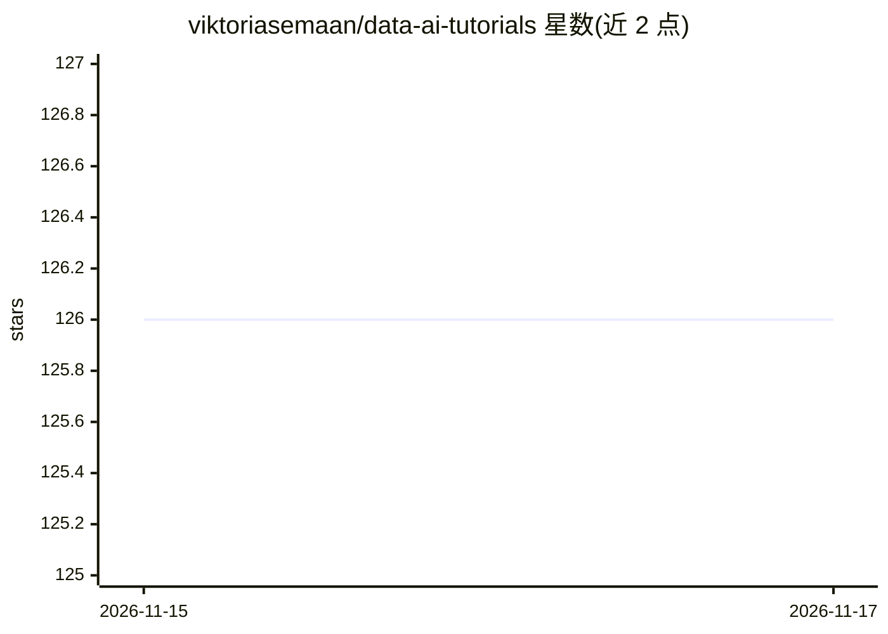

# viktoriasemaan/data-ai-tutorials

⭐ 126 · Jupyter Notebook · MIT · 推送 2026-11-15 · [GitHub](https://github.com/viktoriasemaan/data-ai-tutorials) · 个人维护

**数据与 AI 工程实战教程集：lakehouse 到 AI agent 全链路**

面向从业者与解决方案架构师的数据工程作品集仓库，包含五个递进式教程项目：用 Apple Health 数据构建生产级 lakehouse（Spark/Delta Lake/Unity Catalog）、通过 Managed MCP 将 AI/BI Genie 接入 Claude Desktop、用 Lakebase 与 LangGraph 构建 agent 记忆、比较 Claude Code/Codex/Hermes Agent 三种 harness 的成本差异，以及用 LoRA 做大模型到小模型的蒸馏。每个项目附完整教程、示例数据、架构图与生产模式说明。内容围绕 Databricks 平台展开。

## 筛选速览

| 维度 | 判定 | 备注 |
|---|---|---|
| AI 角色 | `ai-knowledge` | 知识聚合/清单类 |
| 许可风险 | `permissive` | MIT |
| 部署形态 | `None` |  |
| 模型依赖 | — | README 未给出锁定关系 |
| 硬件要求 | — | 无带数字的原话,不猜 |
| 安装摩擦 | `low` | 无编译、无系统依赖或容器化 |
| 成熟度 | — | 结构信号不足 |

## 能力要点

- 五个递进式项目：lakehouse→MCP→agent 记忆→harness 评测→模型蒸馏
- 涵盖 Spark、Delta Lake、Unity Catalog、LangGraph、MLflow、LoRA 等技术
- 教程含隐藏测试评分、成本对比与架构图等生产模式

## 适用场景

- 系统学习从数据管道到 RAG/AI agent 的工程实践
- 了解 Databricks 平台上 MCP、Agent Memory 与模型蒸馏的用法
- 参考 agent harness 成本评测与蒸馏落地方案

## 场景标签

`教程课程` · 领域:学习与行业

## 证据(README 行号)

> L3: Real-world data engineering projects and tutorials covering Data & AI technologies, from your first lakehouse to AI 
> L48: 👋 **About:** This portfolio showcases hands-on data engineering and AI agent projects designed for practitioners an

## 星数曲线

2026-11-15 126 → 2026-11-17 126（+0）

---
*卡片 v1 · prompt 1.4 · 生成 2026-11-17 · 置信度 high · 依据 README sha `ffd21d539b2e` · [字段定义](../../DATASET.md)*
