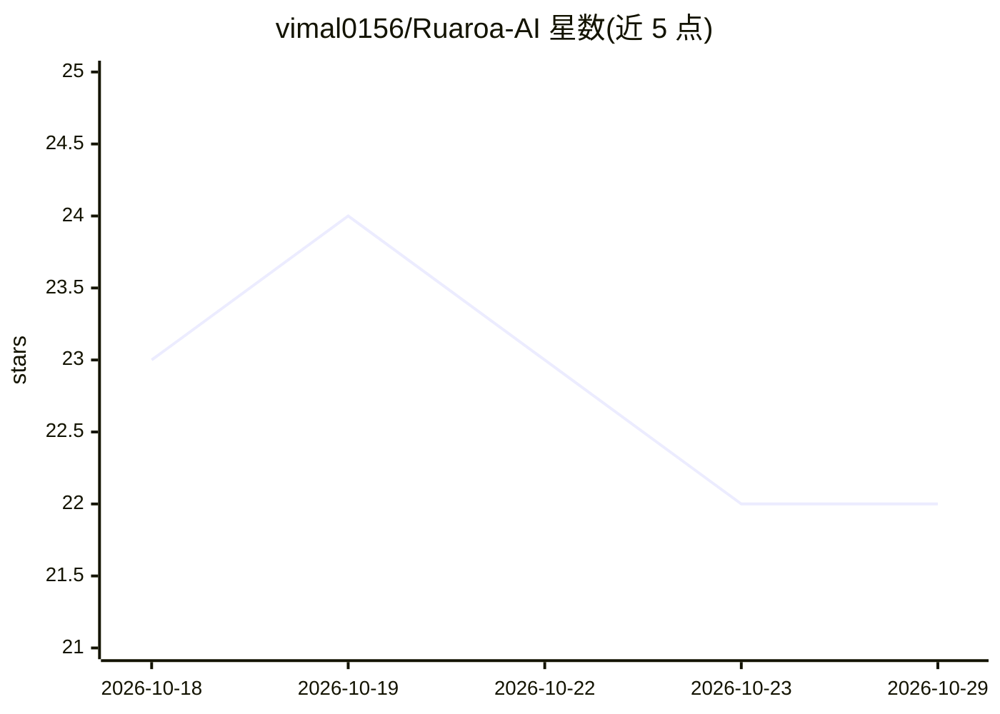

# vimal0156/Ruaroa-AI

⭐ 22 · Python · MIT · 推送 2026-03-12 · [GitHub](https://github.com/vimal0156/Ruaroa-AI) · 个人维护

**零代码 AutoML 工具：用自然语言驱动 LLM agent 自动生成并迭代 ML 代码**

面向不会或不想写代码的数据科学使用者：上传 CSV/JSON/TXT 数据，用自然语言描述目标与评估指标，系统由 LLM agent 生成多个机器学习方案候选，自动运行、评测并迭代优化，最终输出最优的 Python 代码、实验日志与可交互的方案树可视化。提供 Streamlit Web 界面、CLI 命令行与 Python API 三种使用方式；支持 OpenAI/Anthropic API 及通过 OpenAI 兼容端点接入 Ollama 等本地模型；提供 Docker 构建方式与演示视频下载。需 Python 3.10+。

## 筛选速览

| 维度 | 判定 | 备注 |
|---|---|---|
| AI 角色 | `ai-ecosystem` | LLM/agent 周边工具 |
| 许可风险 | `permissive` | MIT |
| 部署形态 | `self-host` | docker 或自建部署 |
| 模型依赖 | local-ok | 支持本地模型 |
| 硬件要求 | — | 无带数字的原话,不猜 |
| 安装摩擦 | `low` | 无编译、无系统依赖或容器化 |
| 成熟度 | — | 结构信号不足 |

## 能力要点

- 自然语言描述任务，自动生成/运行/迭代优化 ML 代码
- 输出最优 Python 代码、实验 journal 与交互式方案树可视化
- Web UI / CLI / Python API 三种使用方式
- 通过 OpenAI 兼容 API 支持 Ollama 等本地 LLM

## 适用场景

- 不写代码，用自然语言完成房价预测、客户流失等 ML 任务
- 让 agent 自动试验多个方案并对比性能指标
- 本地部署 LLM 后离线自动生成机器学习管线

## 场景标签

`数据分析` `代码生成` · 领域:效率与自动化

## 证据(README 行号)

> L36: - Automatically runs, debugs, and improves code
> L163: - `agent.code.model=...` to configure which model the agent should use for coding (default is `gpt-4-turbo`).
> L266: Ruaroa AI employs an intelligent **Solution Space Tree Search** methodology that mirrors the iterative problem-sol

## 星数曲线

2026-10-18 23 → 2026-10-29 22（-1）

---
*卡片 v1 · prompt 1.4 · 生成 2026-10-27 · 置信度 high · 依据 README sha `9c8787075222` · [字段定义](../../DATASET.md)*
