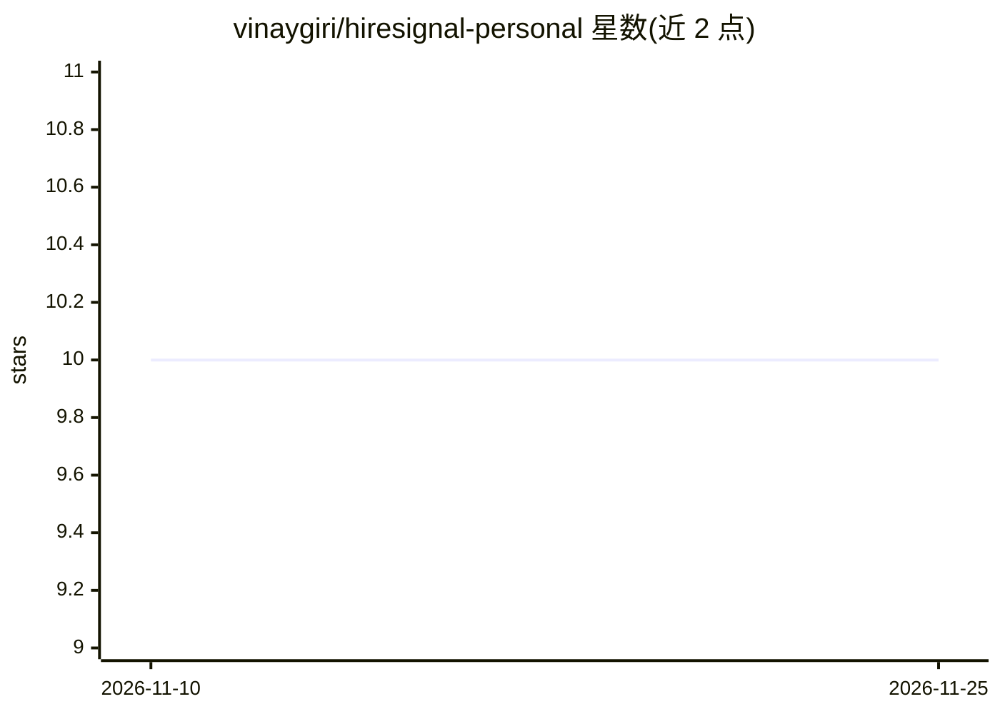

# vinaygiri/hiresignal-personal

⭐ 10 · TypeScript · MIT · 推送 2026-09-01 · [GitHub](https://github.com/vinaygiri/hiresignal-personal) · 个人维护

**求职者本地隐私求职引擎：简历匹配+AI 评分+辅助投递**

单用户、运行在本机的技术岗位求职工具（Next.js + SQLite）：从 ATS API、招聘板和公司官网抓取职位，用向量检索（sqlite-vec）与 BM25 混合匹配简历，结合技能重合度与 LLM 评分给出 0-100 分，并生成公司尽调摘要。辅助投递在可见浏览器中填表后由用户手动提交。默认依赖本地 Ollama 做嵌入与对话，也可换 Gemini/OpenAI 等云端 provider；首次嵌入同步可能耗时 1-3 小时（CPU）。

## 筛选速览

| 维度 | 判定 | 备注 |
|---|---|---|
| AI 角色 | `ai-native` | 本体是模型或模型工具 |
| 许可风险 | `permissive` | MIT |
| 部署形态 | `desktop` | 安装包/桌面程序 |
| 模型依赖 | local-ok | 支持本地模型 |
| 硬件要求 | `cpu-ok` | |
| 安装摩擦 | `low` | 无编译、无系统依赖或容器化 |
| 成熟度 | — | 结构信号不足 |

## 能力要点

- 混合匹配：向量搜索 + BM25 + 技能重合度 + LLM 评分合成 0-100 分并解释原因
- 可搜索约 37,000 个公司招聘板，14 个 ATS 平台经公开 API 拉取
- 辅助投递只填表不代提交，保留用户最终确认
- 本地 SQLite 单文件存储，无账号、无云端

## 适用场景

- 每天同步并筛选与我简历匹配的技术岗位
- 投递前查看公司裁员历史与财务韧性等尽调信息
- 让浏览器自动填写申请表，我检查后提交

## 场景标签

`语义搜索` `浏览器自动化` · 领域:效率与自动化

## 证据(README 行号)

> L12: > **Your private, local job-search engine for technical roles** — semantic résumé matching, AI
> L37: - **Hybrid matching, scored 0-100** — meaning (vector search via sqlite-vec) *and* wording (BM25),
> L56: - **Local & private** — one SQLite file on your machine; no account, no cloud storage.

## 星数曲线

2026-11-10 10 → 2026-11-25 10（+0）

---
*卡片 v1 · prompt 1.4 · 生成 2026-11-19 · 置信度 high · 依据 README sha `376139af42c2` · [字段定义](../../DATASET.md)*
