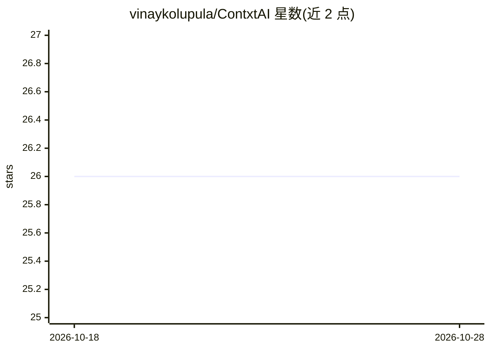

# vinaykolupula/ContxtAI

⭐ 27 · TypeScript · Apache-2.0 · 推送 2026-08-04 · [GitHub](https://github.com/vinaykolupula/ContxtAI) · [官网](https://contxtai.vinaykolupula.com) · 个人维护

**隐私优先的浏览器扩展：一次构建 AI 上下文，跨平台注入**

面向使用多个 AI 平台的用户，ContxtAI 是本地优先的 Chrome 浏览器扩展：创建可复用的上下文配置（项目、写作风格、偏好），一键注入 ChatGPT、Claude、Gemini 的聊天框；支持从对话中提取上下文、划词保存、上下文预算温度计与长对话遗忘警告。注入前经本地 Scrubber 检测并遮蔽密码、密钥等敏感数据。数据存储在浏览器本地 IndexedDB，无账号、无遥测。架构为 pnpm monorepo（核心引擎 + Plasmo 扩展），需从源码构建，亦提供 Chrome 应用商店安装。

## 筛选速览

| 维度 | 判定 | 备注 |
|---|---|---|
| AI 角色 | `ai-ecosystem` | LLM/agent 周边工具 |
| 许可风险 | `permissive` | Apache-2.0 |
| 部署形态 | `library` | 以包/库形式分发 |
| 模型依赖 | — | README 未给出锁定关系 |
| 硬件要求 | — | 无带数字的原话,不猜 |
| 安装摩擦 | `low` | 无编译、无系统依赖或容器化 |
| 成熟度 | — | 结构信号不足 |

## 能力要点

- 一键将上下文配置注入 ChatGPT/Claude/Gemini 聊天框
- 本地 Privacy Scrubber 检测并遮蔽密码、AWS 密钥等敏感数据
- 上下文预算温度计与长对话 Fade Warning 再注入
- 本地优先：IndexedDB 存储，无账号、无遥测、无云端依赖

## 适用场景

- 在多个 AI 平台间复用同一套项目/写作风格上下文，避免重复解释
- 从 AI 对话中提取风格规则沉淀为长期知识资产
- 防止数据库密码等敏感信息随上下文进入云端

## 场景标签

`提示工程` · 领域:Agent 开发

## 证据(README 行号)

> L21: Create reusable context profiles containing your projects, preferences, writing styles, goals, and workflows, then 
> L57: Create structured context profiles containing the information that matters to your work, then inject them into any 
> L141: 1. **`@contxtai/core`**: The platform-agnostic Context Engine. Handles token counting, semantic tag routing, Index

## 星数曲线

2026-10-18 26 → 2026-10-28 26（+0）

---
*卡片 v1 · prompt 1.4 · 生成 2026-10-26 · 置信度 mid · 依据 README sha `e95ce91cecad` · [字段定义](../../DATASET.md)*
