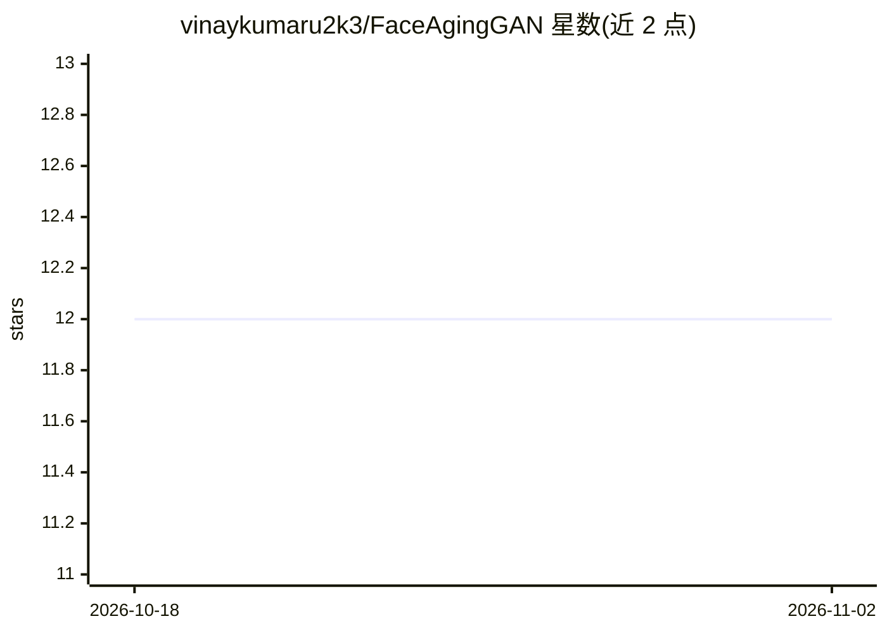

# vinaykumaru2k3/FaceAgingGAN

⭐ 12 · Jupyter Notebook · 推送 2026-06-14 · [GitHub](https://github.com/vinaykumaru2k3/FaceAgingGAN) · 个人维护

**面向法医调查的 GAN 人脸年龄推进与素描转照片系统**

基于生成对抗网络的法医图像处理框架，整合 Pixel2Style2Pixel（pSp）与 HRFAE 两类模型，执行两项任务：人脸图像年龄推进（可指定目标年龄如 65 岁）与素描到照片级人脸的转换。提供训练与测试命令，素描转人脸部分基于 CelebA/CelebAHQ 数据集，年龄编辑部分使用 FFHQ 数据集与年龄标签，支持下载预训练模型推理及自备数据训练。面向法医取证场景的嫌疑人与失踪人口识别等用途，实验环境为 Colab 的 15GB GPU（Tesla T4）。

## 筛选速览

| 维度 | 判定 | 备注 |
|---|---|---|
| AI 角色 | `ai-native` | 本体是模型或模型工具 |
| 许可风险 | `none` | — |
| 部署形态 | `library` | 以包/库形式分发 |
| 模型依赖 | — | README 未给出锁定关系 |
| 硬件要求 | — | 无带数字的原话,不猜 |
| 安装摩擦 | `medium` | 含编译或系统依赖之一 |
| 成熟度 | — | 结构信号不足 |

## 能力要点

- 基于 pSp 的素描到照片级人脸转换
- HRFAE 高分辨率人脸年龄编辑（可指定目标年龄）
- 提供预训练模型下载与 test.py 推理命令
- 支持 FFHQ/自备数据集训练新模型

## 适用场景

- 法医调查中模拟失踪人口多年后的容貌
- 将素描画像转换为照片级人脸辅助嫌疑人识别
- 低质量影像的人脸重建与身份核验

## 场景标签

`图像生成` · 领域:内容生成

## 证据(README 行号)

> L5: We present a GAN-powered framework designed to aid forensic investigations by addressing critical challenges in imag
> L11: - **Accurate Age Progression:** Incorporates HRFAE aging techniques to simulate realistic aging effects.

## 星数曲线

2026-10-18 12 → 2026-11-02 12（+0）

---
*卡片 v1 · prompt 1.4 · 生成 2026-10-31 · 置信度 high · 依据 README sha `ac80a505ccee` · [字段定义](../../DATASET.md)*
