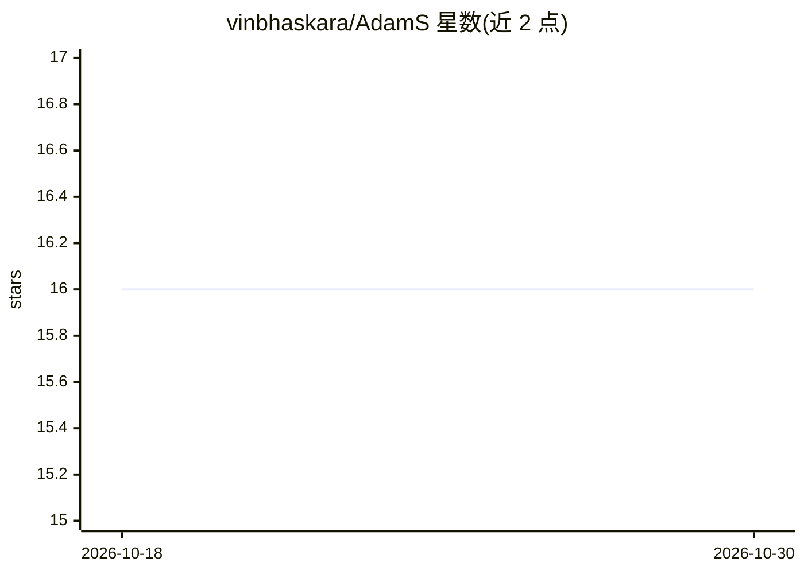

# vinbhaskara/AdamS

⭐ 16 · Python · MIT · 推送 2026-04-30 · [GitHub](https://github.com/vinbhaskara/AdamS) · [官网](https://arxiv.org/abs/1905.13200) · 个人维护

**论文官方 PyTorch 实现：AdamS 优化器及 Adam 变体**

PyTorch 实现，提供论文《Exploiting Uncertainty of Loss Landscape for Stochastic Optimization》（Bhaskara & Desai, 2019, arXiv:1905.13200）中提出的 Adam 优化器变体（AdamS 等），代码位于 optimizers/ 目录。用法与 Adam 相同，但 optimizer.step() 需传入返回 loss 张量的函数，并需指定探索参数 eta（控制沿高不确定方向的梯度噪声标准差）。实验代码基于 CIFAR-10/MNIST 的 LR/MLP/CNN，附三次运行的均值与标准差结果。在 Python <= 3.12.3 与 PyTorch <= 2.7.0 上测试。

## 筛选速览

| 维度 | 判定 | 备注 |
|---|---|---|
| AI 角色 | `ai-ecosystem` | LLM/agent 周边工具 |
| 许可风险 | `permissive` | MIT |
| 部署形态 | `None` |  |
| 模型依赖 | — | README 未给出锁定关系 |
| 硬件要求 | — | 无带数字的原话,不猜 |
| 安装摩擦 | `low` | 无编译、无系统依赖或容器化 |
| 成熟度 | — | 结构信号不足 |

## 能力要点

- AdamS 及 Adam 变体的 PyTorch 实现（optimizers/ 目录）
- 用法与 Adam 一致，额外需传 loss 函数与探索参数 eta
- 附 CIFAR-10/MNIST 上 LR/MLP/CNN 实验复现脚本与结果
- 测试环境为 Python <= 3.12.3、PyTorch <= 2.7.0

## 适用场景

- 在 PyTorch 训练中使用 AdamS 替代 Adam
- 复现论文中 CIFAR-10/MNIST 上的优化器对比实验
- 研究噪声/稀疏数据与低数据量场景下的优化器行为

## 场景标签

`模型训练` · 领域:训练与推理

## 证据(README 行号)

> L1: ## Official implementation of the *AdamS* Optimizer for PyTorch
> L23: PyTorch implementations of the Adam optimizer variants introduced in the paper are available under ``optimizers/``.
> L31: We evaluated the optimizers on multiple models such as Logistic Regression (LR), MLPs, and CNNs on the CIFAR-10/MNI

## 星数曲线

2026-10-18 16 → 2026-10-30 16（+0）

---
*卡片 v1 · prompt 1.4 · 生成 2026-10-30 · 置信度 high · 依据 README sha `d6ae0a7acbf6` · [字段定义](../../DATASET.md)*
