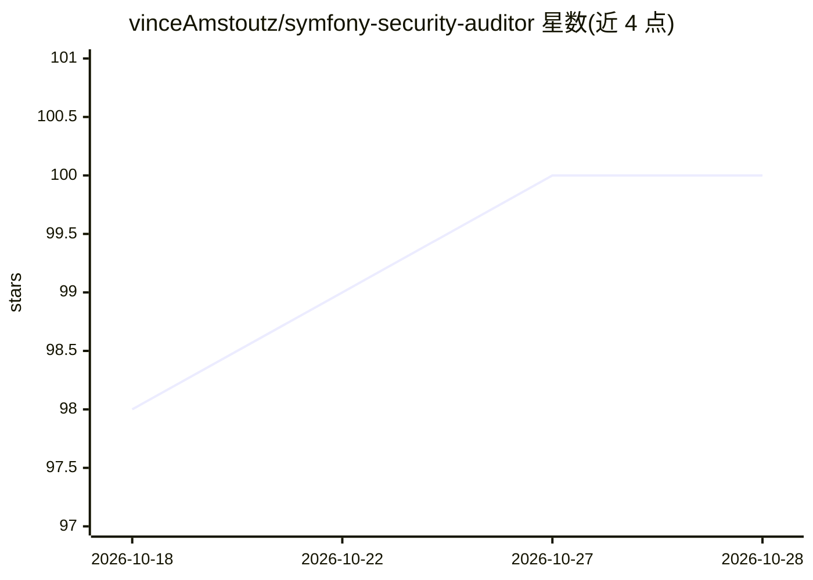

# vinceAmstoutz/symfony-security-auditor

⭐ 100 · PHP · MIT · 推送 2026-10-28 · [GitHub](https://github.com/vinceAmstoutz/symfony-security-auditor) · 个人维护

**给 Symfony 开发者的多 Agent AI 安全审计工具**

面向 Symfony 应用的安全审计工具，通过对抗式 Attacker⚔Reviewer 多 Agent 循环（最多三轮迭代）查找应用层逻辑漏洞（越权、业务逻辑缺陷等），定位为对 PHPStan/Psalm/Progpilot/SAST 工具的补充。经 symfony/ai 实现模型无关，支持多平台 bridge。提供自包含原生二进制（内置 PHP 运行时，Linux/macOS/Windows）与 Symfony bundle 两种使用方式；输出 console/JSON/SARIF/HTML/Markdown 报告，含 --dry-run 成本估算与 MCP 服务模式供 AI 助手调用。多 Agent LLM 循环运行耗时可达分钟级。

## 筛选速览

| 维度 | 判定 | 备注 |
|---|---|---|
| AI 角色 | `ai-native` | 本体是模型或模型工具 |
| 许可风险 | `permissive` | MIT |
| 部署形态 | `desktop` | 安装包/桌面程序 |
| 模型依赖 | local-ok | 支持本地模型 |
| 硬件要求 | — | 无带数字的原话,不猜 |
| 安装摩擦 | `low` | 无编译、无系统依赖或容器化 |
| 成熟度 | — | 结构信号不足 |

## 能力要点

- Attacker⚔Reviewer 对抗循环最多三轮迭代后输出验证报告
- 自包含原生二进制内置 PHP 运行时，支持 Linux/macOS/Windows
- 经 symfony/ai 平台 bridge 实现 provider 无关
- mcp:serve 暴露 MCP 服务器供 Claude Code/Cursor 等 AI 客户端调用

## 适用场景

- 在 CI 中夜间调度对 Symfony 项目做应用层安全审计
- 正式审计前用 --dry-run 估算 token 与成本
- 让 AI 编程助手经 MCP 按需审计项目并读取 JSON 报告

## 场景标签

`多智能体` `网络安全` `代码审查` · 领域:Agent 开发

## 证据(README 行号)

> L5: AI-powered, multi-agent security auditor for Symfony applications. An adversarial **Attacker ⚔ Reviewer** loop catch
> L21: An adversarial **Attacker** agent hunts for vulnerabilities; a skeptical **Reviewer** agent culls false positives o
> L245: `mcp:serve` starts a Model Context Protocol server, so any MCP client — Claude Code, Claude Desktop, Cursor, VS Co

## 星数曲线

2026-10-18 98 → 2026-10-28 100（+2）

---
*卡片 v1 · prompt 1.4 · 生成 2026-10-23 · 置信度 high · 依据 README sha `a1337839706f` · [字段定义](../../DATASET.md)*
