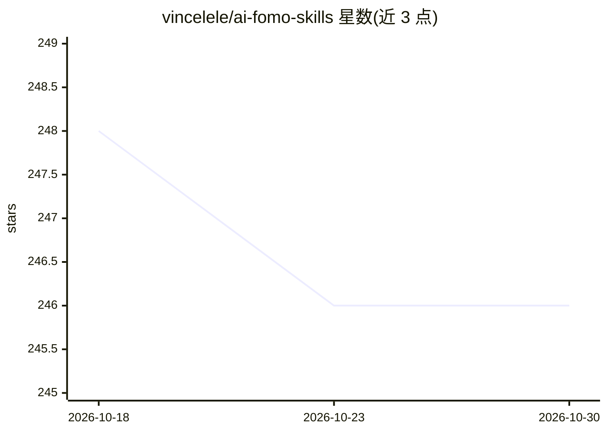

# vincelele/ai-fomo-skills

⭐ 246 · Python · MIT · 推送 2026-05-29 · [GitHub](https://github.com/vincelele/ai-fomo-skills) · 个人维护 · 中文 README

**给 AI 从业者的个人信息筛选 Agent Skill 套件**

由三个 Agent Skill（ai-fomo-init、ai-fomo-sources、ai-fomo）组成的工作流：先通过简历与问答建立个人背景（self-context），再从官网、RSS、GitHub、X、小宇宙、YouTube 等渠道导入内容保存为 raw snapshot，最后由 Agent 判断每条信息属于 write now / ask first / skip，并写入 wiki、signals、digests 形成可复用的个人知识库。支持播客学习笔记生成与小宇宙账号 bridge。面向 AI 创业者、产品经理、独立开发者等使用 Codex、Claude Code、Cursor 等 skill 兼容工具的用户。当前为 alpha/developer preview。

## 筛选速览

| 维度 | 判定 | 备注 |
|---|---|---|
| AI 角色 | `ai-native` | 本体是模型或模型工具 |
| 许可风险 | `permissive` | MIT |
| 部署形态 | `None` |  |
| 模型依赖 | — | README 未给出锁定关系 |
| 硬件要求 | — | 无带数字的原话,不猜 |
| 安装摩擦 | `low` | 无编译、无系统依赖或容器化 |
| 成熟度 | `idea` | |

## 能力要点

- 三个 skill：初始化个人对齐、数据源导入、判断与沉淀
- 支持官网/RSS/GitHub/X/小宇宙/YouTube 等多类数据源，保存可追溯 raw snapshot
- 信息分级为 write now / ask first / skip，沉淀到 wiki/signals/digests
- 小宇宙 bridge：订阅导入、评论抓取、DashScope Fun-ASR 音频转录

## 适用场景

- 让 Agent 按个人背景筛选 AI 信息流，判断哪些值得看
- 把高价值播客转成学习笔记并标注值得听的片段
- 长期沉淀个人 AI 知识库供 Agent 复用

## 场景标签

`知识库管理` · 领域:知识与检索

## 证据(README 行号)

> L10: 这是一套给 **AI 创业者、产品经理、独立开发者** 使用的 Agent Skill。它不是让 Agent 帮你多看一点信息，而是让 Agent 帮你少浪费一点注意力。
> L83: |让 AI 先认识你|`ai-fomo-init`|先请你提供类似简历、个人介绍、项目经历或当前目标的材料，再通过问答补齐个人判断标准。|
> L85: |判断和沉淀|`ai-fomo`|把资料分成 `write now`、`ask first`、`skip`，再写入 wiki、signals 或 digests。|

## 星数曲线

2026-10-18 248 → 2026-10-30 246（-2）

---
*卡片 v1 · prompt 1.4 · 生成 2026-10-22 · 置信度 high · 依据 README sha `0055f0365839` · [字段定义](../../DATASET.md)*
