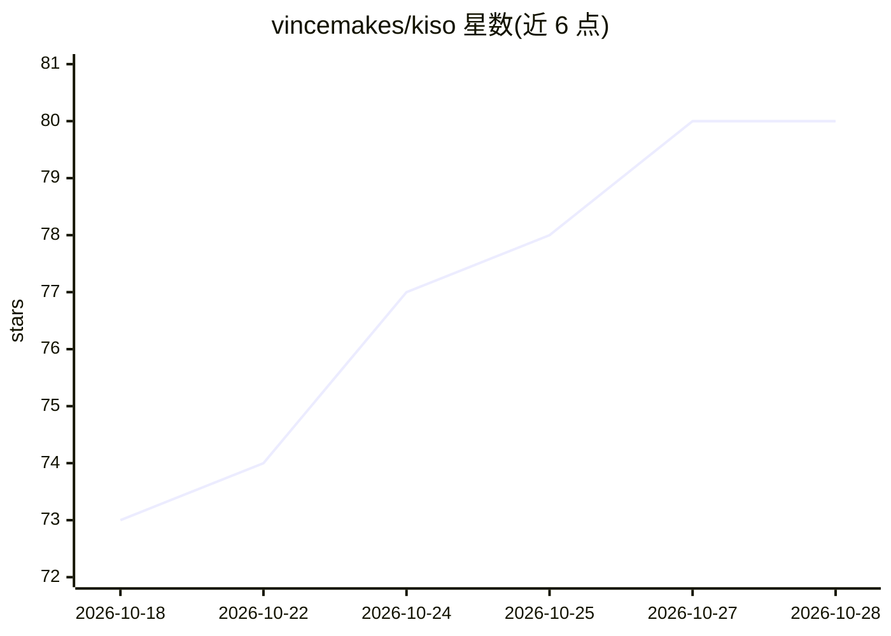

# vincemakes/kiso

⭐ 80 · TypeScript · MIT · 推送 2026-10-27 · [GitHub](https://github.com/vincemakes/kiso) · [官网](https://kiso.work) · 个人维护 · 中文 README

**终端编码 agent 与其持久化运行时内核**

kiso 由两部分组成：上限 2,200 行 TypeScript 的持久化 agent 运行时内核，以及构建其上的终端编码 agent（kiso-code）。核心机制为事件溯源会话：崩溃或终端关闭后可从已提交前缀精确恢复；批准模式构成 deny>allow>ask 链；长任务过半窗口时按阶段压缩上下文。支持 DeepSeek、Claude、GPT、ChatGPT 订阅及任意 OpenAI 兼容网关，密钥不写入配置文件。要求 Node ≥ 22 的 macOS 或 Linux，扩展以 .mjs 文件形式加载，内置 MCP、skills、subagents 等五个。

## 筛选速览

| 维度 | 判定 | 备注 |
|---|---|---|
| AI 角色 | `ai-ecosystem` | LLM/agent 周边工具 |
| 许可风险 | `permissive` | MIT |
| 部署形态 | `library` | 以包/库形式分发 |
| 模型依赖 | locked-api |  |
| 硬件要求 | — | 无带数字的原话,不猜 |
| 安装摩擦 | `low` | 无编译、无系统依赖或容器化 |
| 成熟度 | — | 结构信号不足 |

## 能力要点

- 事件溯源会话，崩溃后从已提交前缀精确恢复
- 批准模式链（deny>allow>ask）与不可恢复目标的强制拒绝规则
- 内核上限 2,200 行，会话为可读 JSONL 日志，46 项 ADR 记录设计决策
- 无密钥首次运行：脚本化演示回合后再连接模型

## 适用场景

- 在终端中让 agent 执行编码任务并在崩溃后继续
- 通过 SDK 用持久化会话存储与类型化事件流构建自己的 agent
- 用批准模式和扩展机制控制 agent 的执行权限

## 场景标签

`Agent 框架` `编码 Agent` · 领域:Agent 开发

## 证据(README 行号)

> L3:  kiso is a durable agent runtime with a kernel capped at 2,200 lines, and a coding agent for your terminal built on 
> L63: The agent is built on `@vincemakes/kiso-runtime`: a durable, append-only session store, an agent factory and a type

## 星数曲线

2026-10-18 73 → 2026-10-28 80（+7）

---
*卡片 v1 · prompt 1.4 · 生成 2026-10-24 · 置信度 high · 依据 README sha `2a8d6e80e2f4` · [字段定义](../../DATASET.md)*
