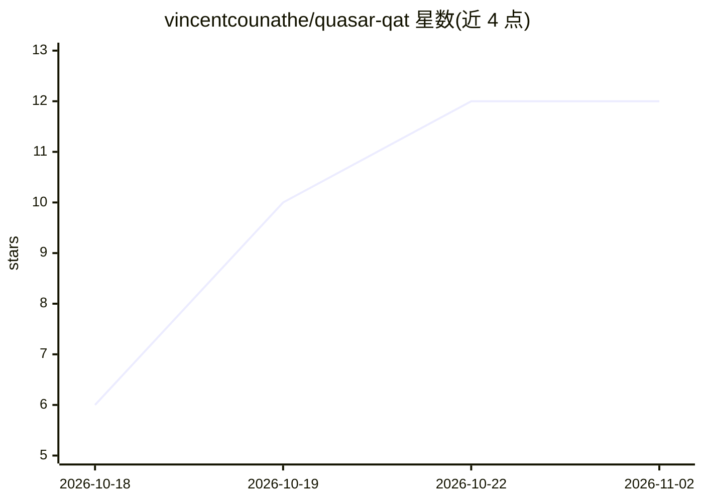

# vincentcounathe/quasar-qat

⭐ 12 · Python · Apache-2.0 · 推送 2026-10-10 · [GitHub](https://github.com/vincentcounathe/quasar-qat) · [官网](https://quasar-qat.github.io/) · 个人维护

**面向 LLM 的量化感知训练（QAT）方法库，支持 INT2/3/4 与 NVFP4**

QUASAR 是一种用于大语言模型的量化感知训练方法：每个训练步搜索若干截断范围并用 AdamW 二阶矩作为显著性的加权最小二乘拟合反量化器，仅改变训练过程，产出的量化模型与 round-to-nearest 检查点格式一致（INT2/3/4 或 NVFP4）。以 Python 包提供，含 FSDP2 训练器、蒸馏微调配方、KL/困惑度/数学/MMLU-Pro 等评测套件与论文复现脚本，训练数据为 JSONL 对话格式。提供多个 Qwen/Gemma 系列量化检查点。

## 筛选速览

| 维度 | 判定 | 备注 |
|---|---|---|
| AI 角色 | `ai-ecosystem` | LLM/agent 周边工具 |
| 许可风险 | `permissive` | Apache-2.0 |
| 部署形态 | `library` | 以包/库形式分发 |
| 模型依赖 | — | README 未给出锁定关系 |
| 硬件要求 | — | 无带数字的原话,不猜 |
| 安装摩擦 | `low` | 无编译、无系统依赖或容器化 |
| 成熟度 | — | 结构信号不足 |

## 能力要点

- 每步搜索截断范围并以 AdamW 二阶矩加权最小二乘拟合反量化器
- 量化输出格式与 round-to-nearest 检查点一致（INT2/3/4 或 NVFP4）
- 含 FSDP2 训练器、蒸馏与微调配方、KL/MMLU-Pro/RULER 等评测套件
- 提供论文复现脚本与多模型量化检查点

## 适用场景

- 对 LLM 做 INT4/INT3/INT2/NVFP4 量化感知训练
- 量化感知蒸馏并导出可直接部署的量化检查点
- 复现论文中 QUASAR 与各 QAT 基线的对比实验

## 场景标签

`模型量化` `微调` · 领域:训练与推理

## 证据(README 行号)

> L12: QUASAR is a quantization-aware training (QAT) method for LLMs. At every training step it reconstructs each
> L36: pip install -e .            # quantizer and trainer

## 星数曲线

2026-10-18 6 → 2026-11-02 12（+6）

---
*卡片 v1 · prompt 1.4 · 生成 2026-10-31 · 置信度 high · 依据 README sha `615da4ab74ab` · [字段定义](../../DATASET.md)*
