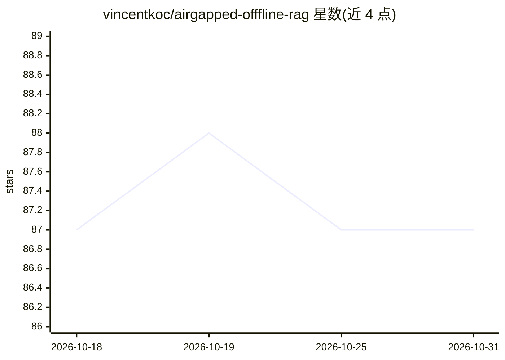

# vincentkoc/airgapped-offfline-rag

⭐ 87 · Python · GPL-3.0 · 推送 2026-04-30 · [GitHub](https://github.com/vincentkoc/airgapped-offfline-rag) · 个人维护

**离线本地运行的文档问答 RAG 系统，供隐私敏感用户使用**

基于 RAG 的文档问答应用：通过 Streamlit 界面上传 PDF，本地用 llama.cpp 推理 Llama 3、Mistral、Gemma 等 GGUF 量化模型生成回答；langchain 负责编排，chromadb 做向量存储，Sentence Transformer 模型首次运行时自动下载。提供 Makefile 安装（Python 3.9）与 Docker 构建运行两种方式，配置经 config.yaml 调整。面向需要在无外网/隐私环境下做文档问答的用户。

## 筛选速览

| 维度 | 判定 | 备注 |
|---|---|---|
| AI 角色 | `ai-native` | 本体是模型或模型工具 |
| 许可风险 | `viral` | GPL-3.0 |
| 部署形态 | `None` |  |
| 模型依赖 | local-ok | 支持本地模型 |
| 硬件要求 | — | 无带数字的原话,不猜 |
| 安装摩擦 | `low` | 无编译、无系统依赖或容器化 |
| 成熟度 | — | 结构信号不足 |

## 能力要点

- 本地 llama.cpp 推理 Llama 3/Mistral/Gemma GGUF 量化模型
- PDF 上传、问答与流式响应，Streamlit 界面
- chromadb 向量存储 + Sentence Transformer 嵌入
- 支持本地 make run 与 Docker 两种运行方式

## 适用场景

- 在离线或隐私敏感环境对 PDF 文档做问答
- 选择不同量化模型在本地运行 RAG
- 通过 Streamlit 界面上传文档并提问获取基于内容的回答

## 场景标签

`文档问答` · 领域:知识与检索

## 证据(README 行号)

> L5: This project by Vincent Koc implements a Retrieval-Augmented Generation (RAG) based Question-Answering system for do
> L50: 1. **Upload PDF documents** using the file uploader.
> L53: 4. Click **"Generate Answer"** to get a response based on the document content.

## 星数曲线

2026-10-18 87 → 2026-10-31 87（+0）

---
*卡片 v1 · prompt 1.4 · 生成 2026-10-23 · 置信度 high · 依据 README sha `fc641015ad01` · [字段定义](../../DATASET.md)*
