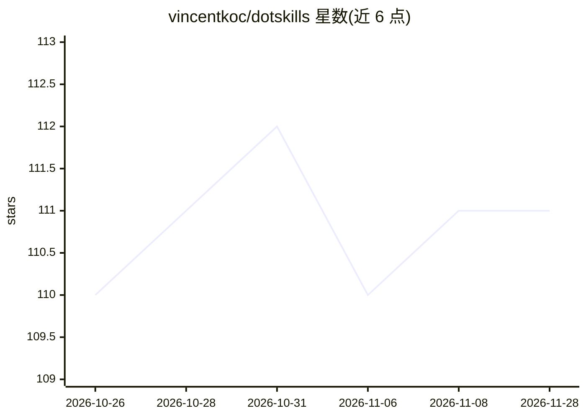

# vincentkoc/dotskills

⭐ 111 · Python · MIT · 推送 2026-11-27 · [GitHub](https://github.com/vincentkoc/dotskills) · 个人维护

**面向 Codex/OpenClaw 等 agent 的可安装技能集合仓库**

作者个人的 .skills 仓库，将原本的一次性 prompt 组织为可安装、版本化、可测试的技能单元（SKILL.md/AGENT.md 加捆绑脚本与参考资源），通过 npx skills add 按技能安装，并通过 make sync 同步到 Codex、Cursor 等 agent 目标的斜杠命令目录。公开收录 24 个技能，覆盖工作流自动化、技术调试、代码库索引、tmux 多 agent 编排等；另支持 private-skills/ 本地私有技能与仓库策略校验（make validate）。本地 sync 仅支持 macOS/Linux。

## 筛选速览

| 维度 | 判定 | 备注 |
|---|---|---|
| AI 角色 | `ai-knowledge` | 知识聚合/清单类 |
| 许可风险 | `permissive` | MIT |
| 部署形态 | `library` | 以包/库形式分发 |
| 模型依赖 | — | README 未给出锁定关系 |
| 硬件要求 | — | 无带数字的原话,不猜 |
| 安装摩擦 | `low` | 无编译、无系统依赖或容器化 |
| 成熟度 | — | 结构信号不足 |

## 能力要点

- 24 个公开技能，npx skills add 按需安装并列出（--list）
- make sync 支持 codex/cursor 目标的技能与斜杠命令同步
- make validate 提供仓库策略、AgentSkills 规范与 OpenAI 元数据三类校验
- 提供 managed_sync.py 的显式源迁移与恢复目录机制

## 适用场景

- 为 Codex/Cursor/OpenClaw 等 agent 工具复用安装现成技能
- 把个人常用 prompt 沉淀为可版本管理的技能仓库
- 批量维护 GitHub 组织的 issue 去重、PR 合入、分支清理等运营流程
- 对技能包做规范校验后发布复用

## 场景标签

`提示工程` · 领域:Agent 开发

## 证据(README 行号)

> L13: We are moving from "prompt as text" to **skill as runtime module**. Each skill acts like a lightweight, containeriz
> L17: This is my personal **.skills** repository for Codex, Cursor, OpenClaw and agent-first tooling. `.skills` is the do
> L45: |Skill|What it does|Install|

## 星数曲线

2026-10-26 110 → 2026-11-28 111（+1）

---
*卡片 v1 · prompt 1.4 · 生成 2026-11-28 · 置信度 high · 依据 README sha `ea9b9a5e984d` · [字段定义](../../DATASET.md)*
