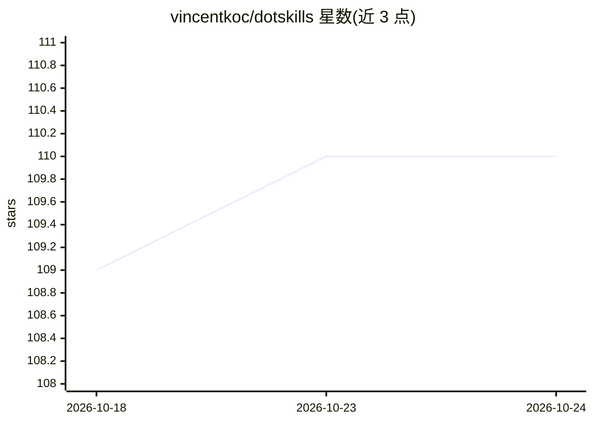

# vincentkoc/dotskills

⭐ 110 · Python · MIT · 推送 2026-10-15 · [GitHub](https://github.com/vincentkoc/dotskills) · 个人维护

**个人维护的 Codex/OpenClaw agent 技能库：可安装复用的技能模块**

作者个人的 .skills 仓库，将 dotfiles 思路应用于 AI 执行：以 SKILL.md/AGENT.md 格式存储可安装、版本化、可测试的技能单元，供 Codex、Cursor、OpenClaw 等 agent 工具使用。公开技能覆盖 20 余项，包括代码库索引 MCP、tmux 会话恢复、Codex 目标历史挖掘、Opik 提示优化、技术文档审计等。通过 npx skills add 按需安装单个技能，make sync 同步技能与 slash 命令（仅限 macOS/Linux），make validate 运行规范校验。本地私有技能须放在被忽略的 private-skills/ 目录，不进入公开仓库。

## 筛选速览

| 维度 | 判定 | 备注 |
|---|---|---|
| AI 角色 | `ai-knowledge` | 知识聚合/清单类 |
| 许可风险 | `permissive` | MIT |
| 部署形态 | `library` | 以包/库形式分发 |
| 模型依赖 | — | README 未给出锁定关系 |
| 硬件要求 | — | 无带数字的原话,不猜 |
| 安装摩擦 | `low` | 无编译、无系统依赖或容器化 |
| 成熟度 | — | 结构信号不足 |

## 能力要点

- 技能即运行时模块：可安装、版本化、测试、跨项目复用
- 20 余个公开技能，通过 npx skills add 按需安装
- make sync 同步 Codex/Cursor 技能与 slash 命令
- make validate 执行仓库策略与 AgentSkills 规范校验

## 适用场景

- 为 Codex/OpenClaw 等 agent 安装现成的开发与运维技能
- 用可测试的技能模块替代一次性 prompt 文本
- 审计和复用个人的 agent 工作流配置

## 场景标签

 · 领域:开发工具/agent 技能库

## 证据(README 行号)

> L17: This is my personal **.skills** repository for Codex, Cursor, OpenClaw and agent-first tooling. `.skills` is the do
> L45: |Skill|What it does|Install|

## 星数曲线

2026-10-18 109 → 2026-10-24 110（+1）

---
*卡片 v1 · prompt 1.4 · 生成 2026-10-23 · 置信度 high · 依据 README sha `8ff7394dcc26` · [字段定义](../../DATASET.md)*
