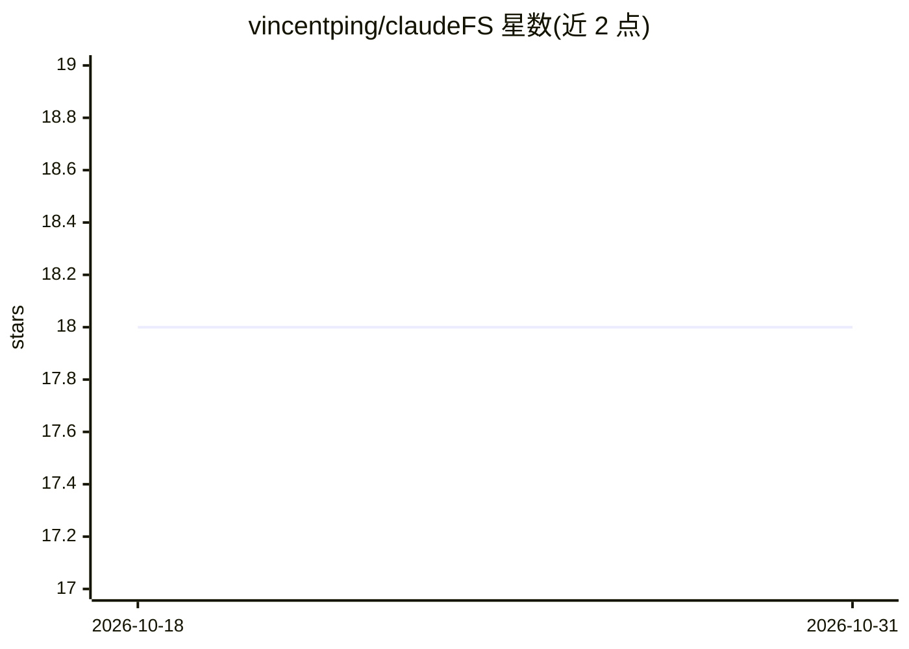

# vincentping/claudeFS

⭐ 18 · JavaScript · MIT · 推送 2026-10-14 · [GitHub](https://github.com/vincentping/claudeFS) · [官网](https://chromewebstore.google.com/detail/claudefs/dgejoeopjlibbnbglaheaokkhmddedcf?authuser=0&hl=en) · 个人维护 · 中文 README

**把本地文件夹接入 claude.ai 的浏览器扩展，让 Claude 直接读写文件**

Chrome/Edge 的 MV3 浏览器扩展：用户在 claude.ai 页面授权一个本地文件夹后，Claude 可在对话中读取、搜索、编辑该文件夹内的纯文本文件（代码/Markdown/JSON/CSV 等），图片与音频经 read_media_file 以原生内容交给 Claude。所有文件操作在本地浏览器运行，扩展自身不向服务器传数据；每次写操作前弹出 diff 确认。无需桌面应用、API key 或命令行，claude.ai 免费版可用。限制：不支持 Office 文档与 PDF，单文件多限 5MB，Chromium 自 2026 年 10 月起拒绝打开 WSL 目录。面向工作内容为文本文件、希望持续与 Claude 讨论而不重复上传的用户。

## 筛选速览

| 维度 | 判定 | 备注 |
|---|---|---|
| AI 角色 | `ai-ecosystem` | LLM/agent 周边工具 |
| 许可风险 | `permissive` | MIT |
| 部署形态 | `None` |  |
| 模型依赖 | locked-api |  |
| 硬件要求 | — | 无带数字的原话,不猜 |
| 安装摩擦 | `low` | 无编译、无系统依赖或容器化 |
| 成熟度 | — | 结构信号不足 |

## 能力要点

- 授权本地文件夹后 Claude 在对话中直接读取、搜索、编辑文件
- 写操作前弹出 diff 确认对话框，用户审批后落盘
- 无桌面应用、无 API key、无命令行，免费版 claude.ai 可用
- 文件操作全部在本地浏览器完成，扩展自身不向服务器传输数据

## 适用场景

- 在浏览器里持续和 Claude 讨论本地代码、笔记与草稿，免重复上传
- 让 Claude 直接把讨论结论写回本地文件，改动经 diff 确认
- 免费版 claude.ai 用户给对话接入本地文件工作区

## 场景标签

`文档问答` · 领域:知识与检索

## 证据(README 行号)

> L7: Connect a local folder to claude.ai — the "FS" stands for file system. A browser extension (MV3) for Chrome and Edge
> L33: 1. Open claude.ai.

## 星数曲线

2026-10-18 18 → 2026-10-31 18（+0）

---
*卡片 v1 · prompt 1.4 · 生成 2026-10-29 · 置信度 high · 依据 README sha `1597080e298a` · [字段定义](../../DATASET.md)*
