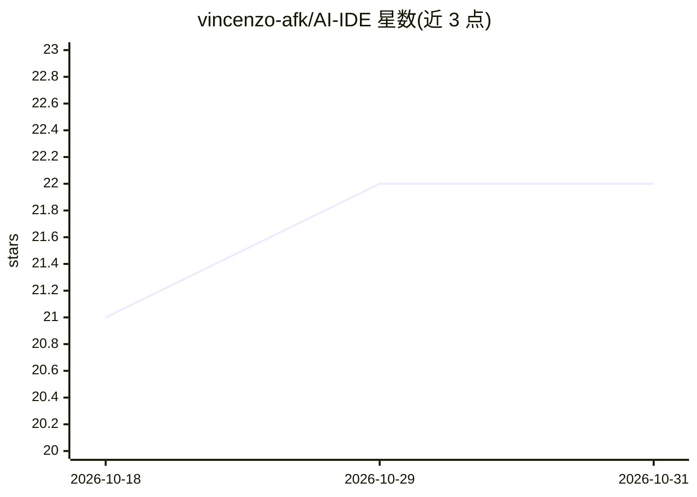

# vincenzo-afk/AI-IDE

⭐ 22 · TypeScript · MIT · 推送 2026-08-21 · [GitHub](https://github.com/vincenzo-afk/AI-IDE) · 个人维护

**对话式 AI 网站工作室：用自然语言生成、预览并发布网站**

基于 React + Express + Vite 的全栈应用：用户以自然语言描述变更，服务端通过 Groq（OpenAI 兼容 Chat Completions API，严格 JSON Schema 输出）生成结构化文件修改，形成不可变修订版本，在沙箱 iframe 中提供桌面/平板/手机实时预览，并发布到 /sites/:slug 公开路由。支持账户会话、按用户项目归属、生成任务队列状态、资源校验与限流；无 Groq key 时进入确定性安全回退模式。当前持久化为本地 JSON 文件，托管数据库、对象存储与多实例部署列为未来升级。

## 筛选速览

| 维度 | 判定 | 备注 |
|---|---|---|
| AI 角色 | `ai-native` | 本体是模型或模型工具 |
| 许可风险 | `permissive` | MIT |
| 部署形态 | `self-host` | docker 或自建部署 |
| 模型依赖 | locked-api |  |
| 硬件要求 | — | 无带数字的原话,不猜 |
| 安装摩擦 | `low` | 无编译、无系统依赖或容器化 |
| 成熟度 | `idea` | |

## 能力要点

- Groq 驱动的自然语言修订生成，严格 JSON Schema 输出与文件路径/大小校验
- 不可变修订历史、恢复流程与沙箱 iframe 实时预览（三种视口）
- 发布到公开路由 /sites/:slug，带限制性内容安全策略
- 无 API key 时的确定性安全回退模式

## 适用场景

- 通过对话式指令快速构建和迭代网页
- 保存与回滚网站的每个修订版本
- 将选定修订版本发布为公开可访问的站点页面

## 场景标签

`代码生成` · 领域:编码与开发

## 证据(README 行号)

> L9: Forgehouse is a conversational AI website studio for creating, revising, previewing, and publishing browser-rendered
> L26: - **Groq-ready generation:** call Groq server-side with strict structured output when `GROQ_API_KEY` is configured.
> L55: |AI integration|Groq OpenAI-compatible Chat Completions API|Uses `GROQ_API_KEY`, configurable `GROQ_MODEL`, and str

## 星数曲线

2026-10-18 21 → 2026-10-31 22（+1）

---
*卡片 v1 · prompt 1.4 · 生成 2026-10-28 · 置信度 mid · 依据 README sha `13c2451a4c7f` · [字段定义](../../DATASET.md)*
