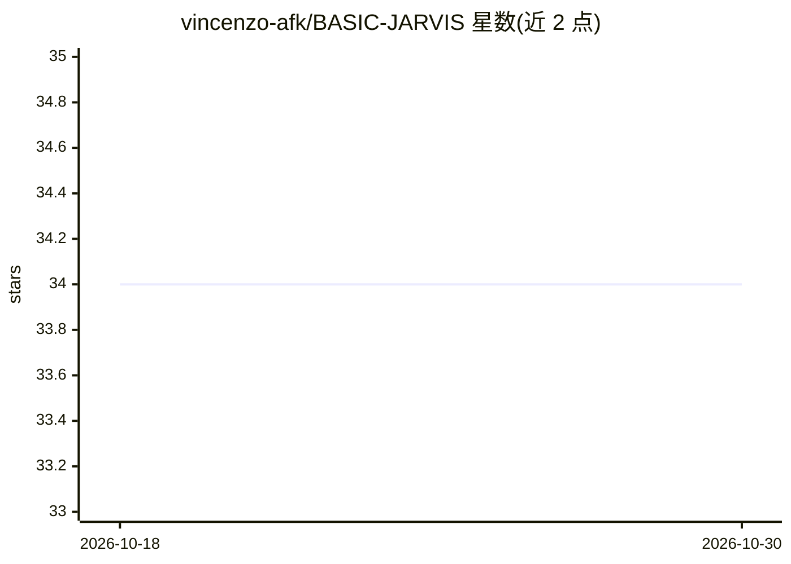

# vincenzo-afk/BASIC-JARVIS

⭐ 34 · Python · NOASSERTION · 推送 2026-10-21 · [GitHub](https://github.com/vincenzo-afk/BASIC-JARVIS) · 个人维护

**本地优先的桌面 AI 助手：Electron+FastAPI+Ollama**

面向本地实验与开发的桌面 AI 助手：Electron/React 前端提供托盘、全局快捷键，本地 FastAPI 后端暴露聊天、屏幕截图/OCR、语音转录与合成（Whisper/Piper）、鼠标键盘与应用控制、多步 agent 工作流及 Python 插件生命周期等路由；LLM 运行时由 Ollama 提供，无需托管 API key。限制：无认证层、CORS 通配、无打包发布产物，需自行准备 Python/Node/Ollama/Tesseract/Piper 等依赖并通过脚本安装运行。

## 筛选速览

| 维度 | 判定 | 备注 |
|---|---|---|
| AI 角色 | `ai-native` | 本体是模型或模型工具 |
| 许可风险 | `permissive` | NOASSERTION |
| 部署形态 | `self-host` | docker 或自建部署 |
| 模型依赖 | local-ok | 支持本地模型 |
| 硬件要求 | — | 无带数字的原话,不猜 |
| 安装摩擦 | `low` | 无编译、无系统依赖或容器化 |
| 成熟度 | — | 结构信号不足 |

## 能力要点

- Ollama 本地 LLM 聊天（含流式、多轮对话、WebSocket）
- 屏幕截图经 OCR 管道提取文字（Tesseract）
- Whisper 转录 + Piper 语音合成，支持语音对话路由
- 多步 agent 工作流与 Python 插件加载/重载/执行

## 适用场景

- 在本机运行一个不依赖云端 API 的桌面 AI 助手
- 通过 API 或语音让助手执行多步自动化任务
- 截图并 OCR 提取屏幕文字交给本地模型处理
- 以插件形式扩展助手能力

## 场景标签

`AI 助手` `工作流自动化` `语音合成` `语音识别` · 领域:效率与自动化

## 证据(README 行号)

> L3: > A local-first desktop AI assistant that combines an Electron interface, a FastAPI backend, and Ollama-powered lang
> L17: BASIC-JARVIS is a local AI desktop assistant for Windows, Linux, and macOS development environments. The Electron d
> L37: - **Local LLM chat:** Send prompts to models available through Ollama, including streaming and multi-turn conversat

## 星数曲线

2026-10-18 34 → 2026-10-30 34（+0）

---
*卡片 v1 · prompt 1.4 · 生成 2026-10-25 · 置信度 mid · 依据 README sha `f1d1b7dcb241` · [字段定义](../../DATASET.md)*
