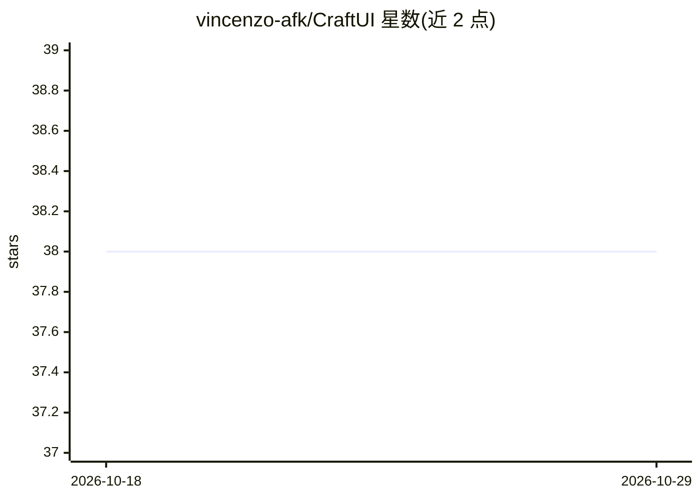

# vincenzo-afk/CraftUI

⭐ 38 · JavaScript · MIT · 推送 2026-08-24 · [GitHub](https://github.com/vincenzo-afk/CraftUI) · [官网](https://craft-ui-swart.vercel.app) · 个人维护

**浏览器端 UI 组件试验场：实时调参预览并导出 HTML/CSS**

无需构建系统的自包含静态网页应用：提供按钮、卡片、弹窗、加载器、阴影、渐变六类组件的实时控制与预览，生成可复制的 HTML/CSS 代码并支持导出独立 HTML 文件。可选接入 Cloudflare Workers AI（@cf/moonshotai/kimi-k2.6 模型），由用户在浏览器面板输入 Cloudflare 凭据后按提示词生成组件代码；凭据存于 localStorage，无服务端代理。核心功能不依赖 API key，运行与部署均为纯静态文件。

## 筛选速览

| 维度 | 判定 | 备注 |
|---|---|---|
| AI 角色 | `ai-enhanced` | 去掉 AI 部分产品仍成立 |
| 许可风险 | `permissive` | MIT |
| 部署形态 | `None` |  |
| 模型依赖 | — | README 未给出锁定关系 |
| 硬件要求 | — | 无带数字的原话,不猜 |
| 安装摩擦 | `low` | 无编译、无系统依赖或容器化 |
| 成熟度 | — | 结构信号不足 |

## 能力要点

- 六类 UI 组件的实时控件与代码生成
- 可选 Cloudflare Workers AI 生成组件代码（kimi-k2.6）
- 明暗主题切换并持久化到 localStorage
- 复制到剪贴板与导出独立 HTML 文件

## 适用场景

- 快速试验并微调常用 UI 组件样式后取用代码
- 让 AI 按提示词生成组件 HTML/CSS 作为起点
- 在任意静态主机上部署使用，无需构建工具

## 场景标签

`代码生成` · 领域:编码与开发

## 证据(README 行号)

> L26: CraftUI is a self-contained static web application for experimenting with common user-interface patterns without a 
> L28: The playground also includes an optional client-side integration with Cloudflare Workers AI using the `@cf/moonshot

## 星数曲线

2026-10-18 38 → 2026-10-29 38（+0）

---
*卡片 v1 · prompt 1.4 · 生成 2026-10-25 · 置信度 high · 依据 README sha `86426c5c0f9a` · [字段定义](../../DATASET.md)*
