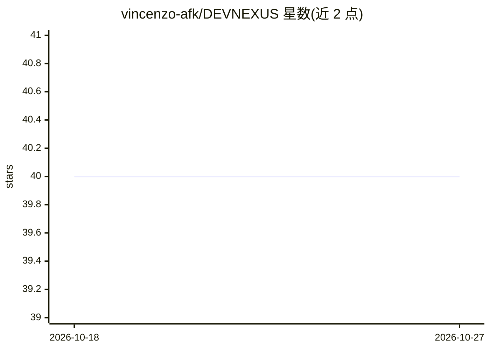

# vincenzo-afk/DEVNEXUS

⭐ 40 · TypeScript · MIT · 推送 2026-09-03 · [GitHub](https://github.com/vincenzo-afk/DEVNEXUS) · [官网](https://devnexus-web.vercel.app/) · 个人维护

**聚合 GitHub 上下文的开发者工作台：AI 叙事、TODO、笔记、黑客松管理**

全栈开发者工作台（Turborepo 单仓：Next.js 前端 + FastAPI 后端 + Supabase/PostgreSQL），把仓库统计、贡献活动、项目笔记、看板 TODO、黑客松规划与实时活动流整合进一个仪表盘。AI 部分通过后端接入 Google Gemini：将近期活动生成日报/周报叙事、AI 优先级与子任务生成、笔记想法扩展，以及基于仓库/笔记/TODO 上下文的问答助手。需自备 GitHub OAuth、Supabase 项目与 Google AI Studio API key，从源码克隆安装运行，支持 PWA。

## 筛选速览

| 维度 | 判定 | 备注 |
|---|---|---|
| AI 角色 | `ai-enhanced` | 去掉 AI 部分产品仍成立 |
| 许可风险 | `permissive` | MIT |
| 部署形态 | `self-host` | docker 或自建部署 |
| 模型依赖 | — | README 未给出锁定关系 |
| 硬件要求 | — | 无带数字的原话,不猜 |
| 安装摩擦 | `low` | 无编译、无系统依赖或容器化 |
| 成熟度 | — | 结构信号不足 |

## 能力要点

- GitHub 命令中心：仓库统计、健康信号与事件流的单一视图
- AI 进度叙事：把开发者活动生成为每日纪事与可分享叙事
- Smart TODO 引擎：语音输入、AI 排序与子任务生成、看板视图
- NEXUS AI 助手：基于仓库、笔记、TODO 与活动上下文问答

## 适用场景

- 在一个仪表盘里追踪我的 GitHub 仓库与贡献活动
- 让 AI 把我最近的提交和 PR 整理成进度叙事
- 备战黑客松时管理阶段、截止日期与 pitch 准备

## 场景标签

`AI 助手` `知识库管理` · 领域:对话与助手

## 证据(README 行号)

> L5: DevNexus is a full-stack developer workspace that brings repository context, AI-assisted progress narratives, notes,
> L27: |**AI Progress Narrator**|Turn recent developer activity into a daily chronicle, weekly arc, and shareable progress
> L31: |**NEXUS AI Assistant**|Ask questions against the context of your repositories, notes, TODOs, activity, and hackath

## 星数曲线

2026-10-18 40 → 2026-10-27 40（+0）

---
*卡片 v1 · prompt 1.4 · 生成 2026-10-25 · 置信度 mid · 依据 README sha `069fcc87b266` · [字段定义](../../DATASET.md)*
