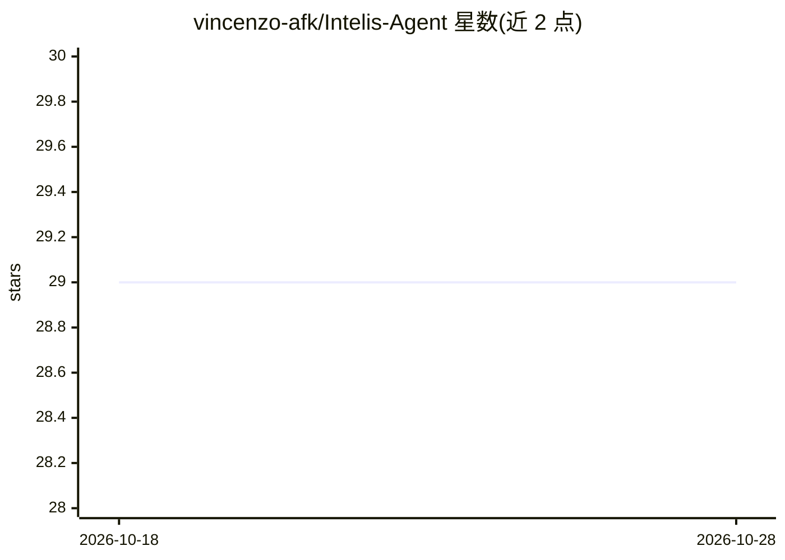

# vincenzo-afk/Intelis-Agent

⭐ 29 · TypeScript · MIT · 推送 2026-09-01 · [GitHub](https://github.com/vincenzo-afk/Intelis-Agent) · [官网](https://intelis-agent.vercel.app) · 个人维护

**自跑式定时网络情报研究 agent：LLM 核验并交付报告**

全栈研究应用：用户用自然语言定义研究目标，选择 Web/RSS/NewsAPI 来源并配置 cron 定时，服务端采集候选材料、经 LLM 流水线分析（信号抽取、质量/相关性/可信度/新颖度评分、验证状态），生成情报报告并通过站内通知与 Resend 邮件交付。Ask Mode 基于已存 findings 回答问题并附引用（finding ID、标题、来源 URL）。前端 React 19 + Vite，后端 Express + tRPC，数据存 MySQL（Drizzle ORM），LLM 经 Groq 的 llama-3.3-70b-versatile。限制：无 Docker 配置，Manus 心跳外的宿主需自行接入调度器。

## 筛选速览

| 维度 | 判定 | 备注 |
|---|---|---|
| AI 角色 | `ai-native` | 本体是模型或模型工具 |
| 许可风险 | `permissive` | MIT |
| 部署形态 | `self-host` | docker 或自建部署 |
| 模型依赖 | locked-api |  |
| 硬件要求 | — | 无带数字的原话,不猜 |
| 安装摩擦 | `low` | 无编译、无系统依赖或容器化 |
| 成熟度 | — | 结构信号不足 |

## 能力要点

- 自然语言研究任务 + 五/六字段 cron 定时执行
- findings 保留来源 URL、摘要与质量/相关性/可信度/新颖度评分
- Ask Mode 仅基于已存 findings 回答并返回引用
- 摘要/摘要简报/告警三类报告，支持 PDF 与 CSV 导出

## 适用场景

- 定时监控特定主题的公开网络信息并收邮件简报
- 追踪公司/人物/话题实体的变更事件与趋势
- 对已采集的 findings 做带引用的问答检索

## 场景标签

 · 领域:信息监控/AI 研究自动化

## 证据(README 行号)

> L3: > A self-running research agent that monitors the web on a schedule, verifies findings with LLM analysis, and delive
> L27: - LLM-backed task-signal derivation, finding analysis, report synthesis, semantic retrieval, and Ask Mode through G

## 星数曲线

2026-10-18 29 → 2026-10-28 29（+0）

---
*卡片 v1 · prompt 1.4 · 生成 2026-10-26 · 置信度 mid · 依据 README sha `2832d9f594f4` · [字段定义](../../DATASET.md)*
