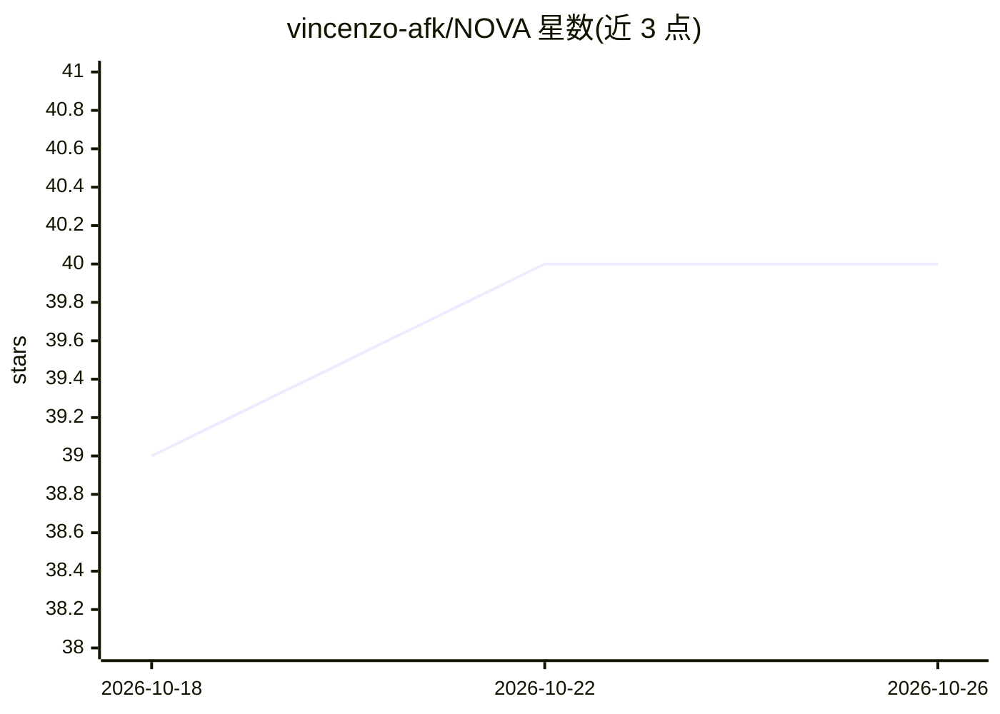

# vincenzo-afk/NOVA

⭐ 40 · Python · 推送 2026-09-19 · [GitHub](https://github.com/vincenzo-afk/NOVA) · 个人维护

**本地优先的 Python 个人 AI 助手：推理、记忆、语音、视觉与设备控制**

Python 编写的桌面个人助手：以单一编排层整合 LLM 路由（云端厂商与 Ollama 本地回退、多密钥轮换）、mem0/ChromaDB 持久记忆、唤醒词与离线/在线语音、屏幕理解（Gemini Vision、OmniParser）、浏览器与桌面控制、PDF/DOCX 文档摄取检索、ADB 安卓工具与定时任务。面向需要对话窗口之外能力的个人用户，通过 CLI/GUI/Telegram/语音交互。提供风险评分、确认门与紧急停止等安全层。裸机安装需 FFmpeg、mpg123 等系统依赖；Docker 部署默认禁用多项主机交互，非桌面控制替代。

## 筛选速览

| 维度 | 判定 | 备注 |
|---|---|---|
| AI 角色 | `ai-native` | 本体是模型或模型工具 |
| 许可风险 | `none` | — |
| 部署形态 | `self-host` | docker 或自建部署 |
| 模型依赖 | local-ok | 支持本地模型 |
| 硬件要求 | — | 无带数字的原话,不猜 |
| 安装摩擦 | `low` | 无编译、无系统依赖或容器化 |
| 成熟度 | — | 结构信号不足 |

## 能力要点

- 统一 LLM 编排：云端厂商 + Ollama 本地回退、多密钥轮换
- mem0 集成与 ChromaDB 本地向量存储、混合检索
- 语音（唤醒词/VAD/离线 STT）与视觉/桌面/浏览器/ADB 控制一体化
- 风险评分、确认门、紧急停止等安全护栏层

## 适用场景

- 通过语音或 Telegram 与本地助手对话并让它操作桌面与浏览器
- 让助手摄取本地 PDF/DOCX 文档并跨会话记忆检索
- 设定定时任务与目标让助手自主执行（带步数限制与循环检测）
- 通过 ADB 控制安卓设备并监控手机状态

## 场景标签

`AI 助手` `浏览器自动化` `GUI 自动化` · 领域:效率与自动化

## 证据(README 行号)

> L27: NOVA is a Python desktop assistant that places a single orchestration layer over language models, persistent memory
> L29: NOVA is designed for workflows that need more than a chat window. It can route requests across configured cloud pro

## 星数曲线

2026-10-18 39 → 2026-10-26 40（+1）

---
*卡片 v1 · prompt 1.4 · 生成 2026-10-25 · 置信度 mid · 依据 README sha `eadb5b70db68` · [字段定义](../../DATASET.md)*
