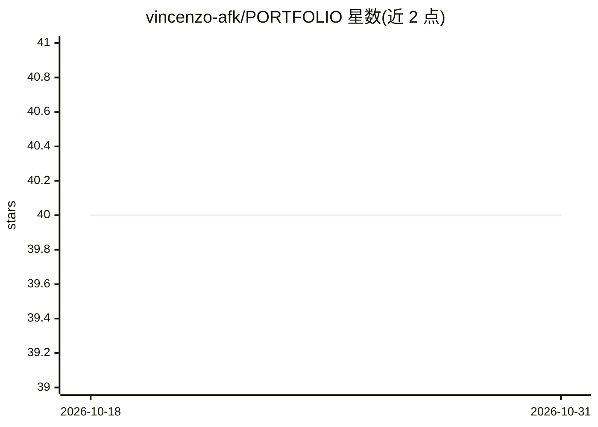

# vincenzo-afk/PORTFOLIO

⭐ 40 · HTML · NOASSERTION · 推送 2026-08-22 · [GitHub](https://github.com/vincenzo-afk/PORTFOLIO) · [官网](https://vincenzo-afk.vercel.app) · 个人维护

**开发者个人单页作品集网站（暗色主题、零构建）**

Bharani Kumar S 的单页个人作品集网站：原生 HTML5/CSS3/JavaScript 实现，无构建步骤，含滚动动画、光标聚光灯效果、SEO 结构化数据，以及经 Vercel Serverless Functions 接入 Resend API 的联系表单（POST /api/send）。展示 46+ 个 AI 与全栈项目卡片，通过编辑 index.html 的 work-card 区块更新项目列表。支持部署到 Vercel 或 GitHub Pages（后者联系表单不可用），联系方式需配置 RESEND_API_KEY。

## 筛选速览

| 维度 | 判定 | 备注 |
|---|---|---|
| AI 角色 | `ai-enhanced` | 去掉 AI 部分产品仍成立 |
| 许可风险 | `permissive` | NOASSERTION |
| 部署形态 | `None` |  |
| 模型依赖 | — | README 未给出锁定关系 |
| 硬件要求 | — | 无带数字的原话,不猜 |
| 安装摩擦 | `low` | 无编译、无系统依赖或容器化 |
| 成熟度 | — | 结构信号不足 |

## 能力要点

- 零构建步骤的单页静态架构
- Resend API + Vercel Serverless Functions 联系表单
- SEO 元标签、Open Graph 与 JSON-LD 结构化数据
- 提供 Vercel 与 GitHub Pages 两种部署路径

## 适用场景

- 作为个人开发者作品集展示项目与技能
- 克隆后修改 index.html 定制为自己的作品集
- 学习零依赖静态站 + Serverless 表单的架构

## 场景标签

 · 领域:Web/个人网站

## 证据(README 行号)

> L2: > Dark, lime-accented one-page portfolio of Bharani Kumar S — an AI full-stack developer.
> L23: - 🛠️ **Project Showcase:** Dynamic grid featuring 46+ selected AI and full-stack projects.

## 星数曲线

2026-10-18 40 → 2026-10-31 40（+0）

---
*卡片 v1 · prompt 1.4 · 生成 2026-10-25 · 置信度 low · 依据 README sha `058823da3c8d` · [字段定义](../../DATASET.md)*
