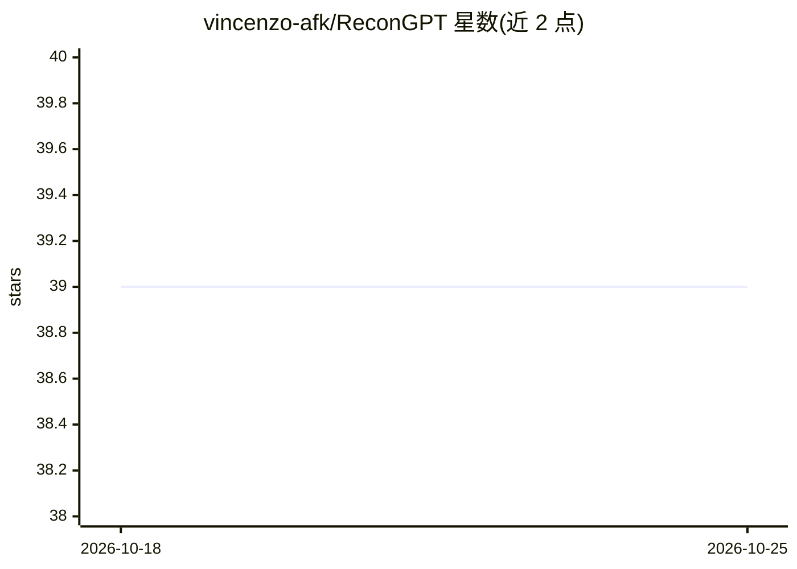

# vincenzo-afk/ReconGPT

⭐ 39 · TypeScript · MIT · 推送 2026-09-01 · [GitHub](https://github.com/vincenzo-afk/ReconGPT) · [官网](https://recon-gpt.vercel.app) · 个人维护

**给安全分析师的证据优先被动 OSINT 案卷工具，含 AI 助手**

面向授权范围内的攻击面调查：接受域名、IP、URL、邮箱、用户名、组织、电话或 ASN 作为目标，按目标类型选择适用的被动采集器（共 40 个模块，如证书透明、DNS、WHOIS、Shodan、VirusTotal 等），通过 SSE 实时流式展示采集进度。产出带证据质量标签（direct/corroborated/context/lead）、来源计数、时效与限制的发现，配实体图谱与 JSON/Markdown/HTML 报告导出。含 AI 聊天助手，需自建 MySQL 数据库与 OAuth 配置。

## 筛选速览

| 维度 | 判定 | 备注 |
|---|---|---|
| AI 角色 | `ai-native` | 本体是模型或模型工具 |
| 许可风险 | `permissive` | MIT |
| 部署形态 | `library` | 以包/库形式分发 |
| 模型依赖 | — | README 未给出锁定关系 |
| 硬件要求 | — | 无带数字的原话,不猜 |
| 安装摩擦 | `low` | 无编译、无系统依赖或容器化 |
| 成熟度 | — | 结构信号不足 |

## 能力要点

- 40 个被动采集模块，按目标类型自动选择
- 发现携带证据质量标签（direct/corroborated/context/lead）与来源出处
- SSE 实时流式呈现长时间采集运行进度
- 实体图谱、历史差量对比与 JSON/Markdown/HTML 案卷报告导出

## 适用场景

- 对授权目标做被动侦察并保留证据与缺口记录
- 梳理域名/IP/用户名等公开信息之间的实体关联
- 生成带证据账本与限制说明的可交付调查报告

## 场景标签

`网络安全` · 领域:学习与行业

## 证据(README 行号)

> L18: ReconGPT is built for the first practical question in an investigation: **what can be corroborated from public info
> L22: ReconGPT does not present a source snippet as proof. Findings carry evidence-quality and lead-status labels, source
> L120: The registry contains **40 passive modules**. Selectors are target-aware: a phone module will not run for a domain

## 星数曲线

2026-10-18 39 → 2026-10-25 39（+0）

---
*卡片 v1 · prompt 1.4 · 生成 2026-10-25 · 置信度 high · 依据 README sha `a9f273eef0b4` · [字段定义](../../DATASET.md)*
