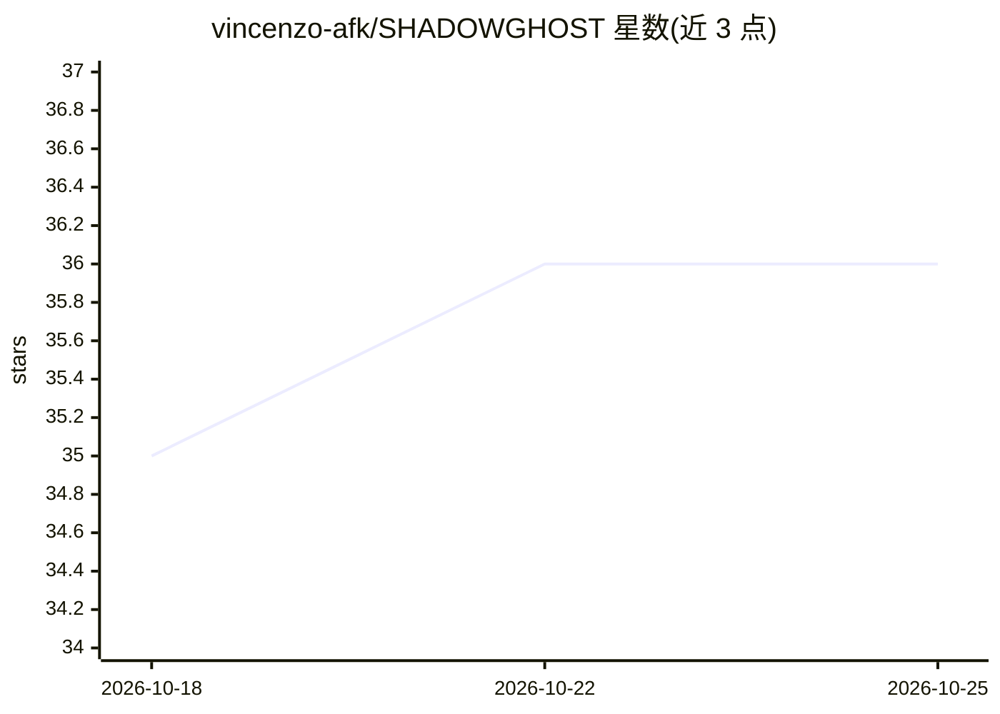

# vincenzo-afk/SHADOWGHOST

⭐ 36 · Python · Apache-2.0 · 推送 2026-08-24 · [GitHub](https://github.com/vincenzo-afk/SHADOWGHOST) · 个人维护

**本地 WiFi CSI 感知应用：无摄像头的人体存在/区域/活动检测**

本地 Python 应用：回放或仿真 WiFi 信道状态信息（CSI），将 56 子载波幅度帧转为实时浏览器仪表盘。后端组合 Isolation Forest 与自编码器式重建模型做异常检测，将信号能量映射为左/中/右三区并估计占用人数，用特征管线（时域统计、FFT、小波等）分类行走/坐/站等六种活动，配合马尔可夫模型预测下一区域，事件写入 SQLite。缺少真实 .dat 采集时自动生成确定性合成场景；Groq 语音播报为可选。需 Python 3.10+，无托管演示，API 本地无鉴权。

## 筛选速览

| 维度 | 判定 | 备注 |
|---|---|---|
| AI 角色 | `ai-native` | 本体是模型或模型工具 |
| 许可风险 | `permissive` | Apache-2.0 |
| 部署形态 | `self-host` | docker 或自建部署 |
| 模型依赖 | locked-api |  |
| 硬件要求 | — | 无带数字的原话,不猜 |
| 安装摩擦 | `low` | 无编译、无系统依赖或容器化 |
| 成熟度 | — | 结构信号不足 |

## 能力要点

- 六种场景（walking/sitting/standing/pacing/empty/crowd）回放或合成
- Isolation Forest + 自编码器式重建的移动/异常评分
- 三区能量映射、占用估计与 HGBT/校准 SVM 活动分类
- Flask-SocketIO 实时仪表盘 + SQLite 事件记录，Groq 叙述可选

## 适用场景

- 无摄像头、无穿戴设备的房间占用与活动监测原型验证
- 用合成或自采 CSI 数据评估感知模型管线
- 通过本地仪表盘或 REST API 查看实时区域与活动判定

## 场景标签

 · 领域:物联网/无线感知

## 证据(README 行号)

> L39: SHADOWGHOST is a local Python application that replays or simulates WiFi **Channel State Information (CSI)** and tu
> L46: - Computes movement scores using an Isolation Forest and an autoencoder-style `MLPRegressor` reconstruction model t
> L48: - Classifies activity with a feature pipeline that includes time-domain statistics, FFT bands, optional wavelets, p

## 星数曲线

2026-10-18 35 → 2026-10-25 36（+1）

---
*卡片 v1 · prompt 1.4 · 生成 2026-10-25 · 置信度 mid · 依据 README sha `213b2d4c7a64` · [字段定义](../../DATASET.md)*
