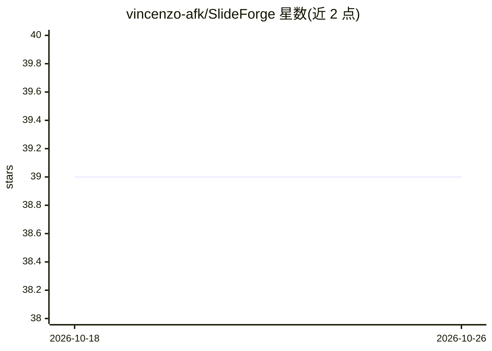

# vincenzo-afk/SlideForge

⭐ 39 · JavaScript · MIT · 推送 2026-08-22 · [GitHub](https://github.com/vincenzo-afk/SlideForge) · [官网](https://vincenzo-afk.github.io/SlideForge) · 个人维护

**浏览器端 AI 演示文稿生成器：输入主题生成可编辑幻灯片**

纯 HTML+CSS+原生 JavaScript 的静态单页应用，零框架、零构建、零服务器。用户输入主题后调用 LLM 生成完整幻灯片（标题、要点、演讲备注、主题配色），支持行内编辑、localStorage 保存（最近 10 份）、PDF 导出与手写 OOXML/ZIP 代码生成的原生 PPTX 导出。AI 后端默认 Google Gemini REST API，或任意 OpenAI 兼容端点（含 LocalAI、LM Studio、vLLM 等自托管方案）。配置集中在 js/config.js 单文件（含 API key），限制：PPTX 不支持复杂形状/图表/SmartArt，公开部署时 key 暴露在 config.js 中需使用代理。

## 筛选速览

| 维度 | 判定 | 备注 |
|---|---|---|
| AI 角色 | `ai-native` | 本体是模型或模型工具 |
| 许可风险 | `permissive` | MIT |
| 部署形态 | `self-host` | docker 或自建部署 |
| 模型依赖 | local-ok | 支持本地模型 |
| 硬件要求 | — | 无带数字的原话,不猜 |
| 安装摩擦 | `low` | 无编译、无系统依赖或容器化 |
| 成熟度 | — | 结构信号不足 |

## 能力要点

- 单主题提示词生成整副幻灯片：标题、要点、演讲备注与匹配配色
- 零依赖、零构建：手写 OOXML+ZIP 生成原生 PPTX，不用 JSZip 等库
- 默认 Gemini，可切换任意 OpenAI 兼容端点（Groq/OpenRouter/LocalAI/LM Studio/vLLM）
- PDF（1280×720）导出、行内编辑与 localStorage 持久化

## 适用场景

- 输入一个主题快速得到可编辑的幻灯片草稿
- 无账号无订阅地本地或静态托管使用 AI 生成演示
- 导出为原生 PPTX 或 PDF 继续加工

## 场景标签

`AI 写作` · 领域:内容生成

## 证据(README 行号)

> L27: SlideForge is a **fully client-side presentation generator**. You type a topic — "The history of space exploration"
> L70: |AI backend|Google Gemini REST API (default) or any OpenAI-compatible endpoint|Optional free tier; key stored in `j

## 星数曲线

2026-10-18 39 → 2026-10-26 39（+0）

---
*卡片 v1 · prompt 1.4 · 生成 2026-10-25 · 置信度 mid · 依据 README sha `63050a66c71e` · [字段定义](../../DATASET.md)*
