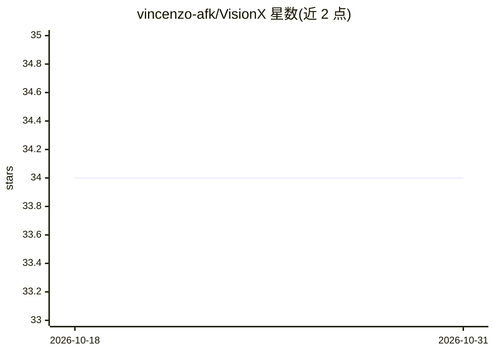

# vincenzo-afk/VisionX

⭐ 34 · Python · MIT · 推送 2026-08-21 · [GitHub](https://github.com/vincenzo-afk/VisionX) · 个人维护

**实时目标检测、跟踪与视频分析平台（YOLOv8+FastAPI）**

基于 Ultralytics YOLOv8 与 FastAPI 构建的计算机视觉平台，提供图像检测、多目标跟踪（ByteTrack/BoT-SORT）、区域与越线计数、实时 Web 仪表盘与 REST API。支持自定义 YOLO 格式数据集微调（含内置 pothole 检测管线），检测事件自动写入关系型数据库。通过 git clone 源码安装，需 Python 3.10+，GPU（CUDA）为可选项，默认 yolov8n.pt 在 CPU 上运行。面向需要部署视频智能分析的开发者。

## 筛选速览

| 维度 | 判定 | 备注 |
|---|---|---|
| AI 角色 | `ai-native` | 本体是模型或模型工具 |
| 许可风险 | `permissive` | MIT |
| 部署形态 | `library` | 以包/库形式分发 |
| 模型依赖 | — | README 未给出锁定关系 |
| 硬件要求 | — | 无带数字的原话,不猜 |
| 安装摩擦 | `medium` | 含编译或系统依赖之一 |
| 成熟度 | — | 结构信号不足 |

## 能力要点

- 图像检测、多目标跟踪（ByteTrack/BoT-SORT）与区域/越线计数
- FastAPI 异步处理与实时 Web 控制面板、REST API
- 自定义数据集微调管线（含 pothole 检测示例）
- 检测事件持久化到关系型数据库

## 适用场景

- 对视频流做实时目标检测与多目标跟踪
- 交通监控或零售场景的区域计数与越线统计
- 用自己的数据集微调 YOLO 模型并部署为 API 服务

## 场景标签

`目标检测` `微调` · 领域:感知与多模态

## 证据(README 行号)

> L8: VisionX is a production-grade, modular computer vision intelligence platform engineered for real-time object detecti
> L13: - **Detect** objects in static images with high-precision bounding boxes and confidence scores.
> L14: - **Track** multiple objects across video frames using state-of-the-art algorithms (ByteTrack/BoT-SORT).

## 星数曲线

2026-10-18 34 → 2026-10-31 34（+0）

---
*卡片 v1 · prompt 1.4 · 生成 2026-10-25 · 置信度 mid · 依据 README sha `5e0cb8ce7908` · [字段定义](../../DATASET.md)*
