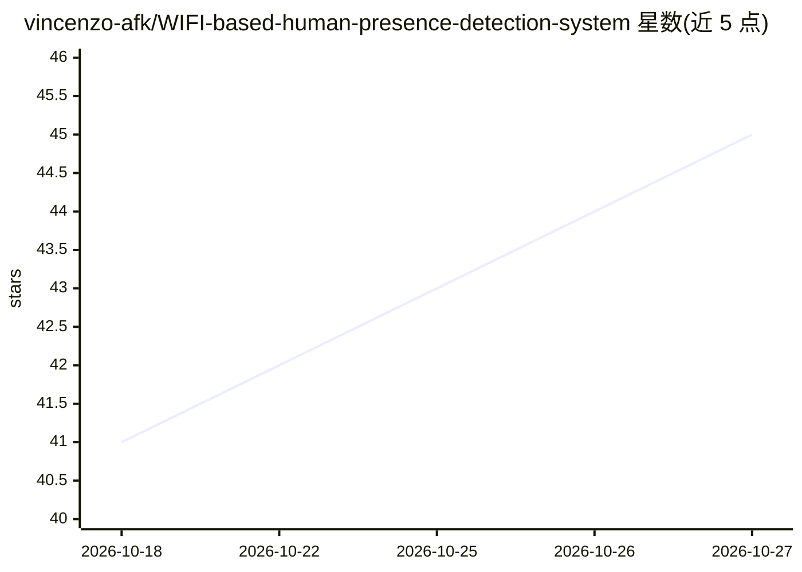

# vincenzo-afk/WIFI-based-human-presence-detection-system

⭐ 45 · Python · Apache-2.0 · 推送 2026-08-23 · [GitHub](https://github.com/vincenzo-afk/WIFI-based-human-presence-detection-system) · 个人维护

**基于 WiFi CSI 的人体存在/区域/活动检测实时仪表盘**

本地 Flask Web 应用，读取 WiFi 信道状态信息（CSI）幅度数据，估计人体存在与运动、粗划分左/中/右区域、占用人数，并分类 WALKING/SITTING 等六种活动，通过 Flask-SocketIO 将遥测流式推送到浏览器雷达式仪表盘。管线含归一化、空房基线、Kalman 风格平滑、区域转移预测，事件记录至 SQLite，可选接入 Groq 做标签校验与态势报告。默认回放六个内置合成场景，无需 CSI 采集文件或专用传感硬件即可运行；实际 CSI 回放需兼容 CSIKit 安装与采集数据。API 无鉴权与限流，无 Docker 或部署清单，无自动化测试套件。

## 筛选速览

| 维度 | 判定 | 备注 |
|---|---|---|
| AI 角色 | `ai-native` | 本体是模型或模型工具 |
| 许可风险 | `permissive` | Apache-2.0 |
| 部署形态 | `self-host` | docker 或自建部署 |
| 模型依赖 | — | README 未给出锁定关系 |
| 硬件要求 | — | 无带数字的原话,不猜 |
| 安装摩擦 | `low` | 无编译、无系统依赖或容器化 |
| 成熟度 | — | 结构信号不足 |

## 能力要点

- CSI 幅度帧的移动检测、占用估计与六类活动分类
- 左/中/右三带粗区域分析与区域转移预测
- Flask-SocketIO 实时帧流推送至浏览器仪表盘
- 默认合成场景回放，无 CSI 硬件或采集文件即可运行

## 适用场景

- 在浏览器中实时查看室内人体存在、活动与占用情况
- 无需摄像头或专用硬件时演示/验证 CSI 感知管线
- 回放六种内置活动场景并录制 NDJSON 会话数据

## 场景标签

 · 领域:感知/人体活动识别

## 证据(README 行号)

> L20: This repository contains a local web application that analyzes WiFi Channel State Information (CSI) amplitude data 
> L29: - **Activity labels** for `WALKING`, `SITTING`, `STANDING`, `PACING`, `EMPTY`, and `CROWD`.

## 星数曲线

2026-10-18 41 → 2026-10-27 45（+4）

---
*卡片 v1 · prompt 1.4 · 生成 2026-10-25 · 置信度 mid · 依据 README sha `7de3d859bc9e` · [字段定义](../../DATASET.md)*
