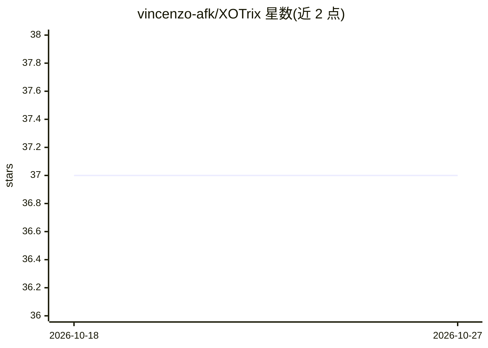

# vincenzo-afk/XOTrix

⭐ 37 · JavaScript · MIT · 推送 2026-08-24 · [GitHub](https://github.com/vincenzo-afk/XOTrix) · [官网](https://xo-trix.vercel.app) · 个人维护

**浏览器井字棋游戏：内置可调难度的 minimax 电脑玩家**

纯静态客户端井字棋游戏：HTML+CSS+原生 JavaScript，无构建步骤与后端，数据存于浏览器 localStorage。支持人人、人机、机机三种模式，电脑玩家使用带 alpha-beta 剪枝的 minimax 搜索，按难度分搜索深度，Master 难度带开局库。提供撤销、悔棋、回放导航与 replay URL 分享、本地统计（含 Elo）、6 套主题、键盘操作与响应式布局。已知限制：无多人联网、无账号与后端排行榜。

## 筛选速览

| 维度 | 判定 | 备注 |
|---|---|---|
| AI 角色 | `ai-enhanced` | 去掉 AI 部分产品仍成立 |
| 许可风险 | `permissive` | MIT |
| 部署形态 | `None` |  |
| 模型依赖 | — | README 未给出锁定关系 |
| 硬件要求 | — | 无带数字的原话,不猜 |
| 安装摩擦 | `low` | 无编译、无系统依赖或容器化 |
| 成熟度 | — | 结构信号不足 |

## 能力要点

- minimax + alpha-beta 剪枝，4 档难度与 Master 开局库
- replay URL（?replay= 参数）重建并分享对局
- 本地统计含 Elo、连胜、成就，存储于 localStorage
- 纯静态无构建、无后端、无 API key，git clone 后本地 HTTP 服务器即可运行

## 适用场景

- 在浏览器直接玩井字棋，选不同难度的电脑对手
- 通过 URL 分享并回放对局
- 查看本地战绩统计与 Elo 评分

## 场景标签

 · 领域:游戏/前端

## 证据(README 行号)

> L19: The game supports local two-player sessions, human-versus-bot play, and bot-versus-bot demonstrations. The bot uses
> L25: - Minimax with alpha-beta pruning, plus Master-level opening responses.

## 星数曲线

2026-10-18 37 → 2026-10-27 37（+0）

---
*卡片 v1 · prompt 1.4 · 生成 2026-10-25 · 置信度 high · 依据 README sha `3b64127005be` · [字段定义](../../DATASET.md)*
