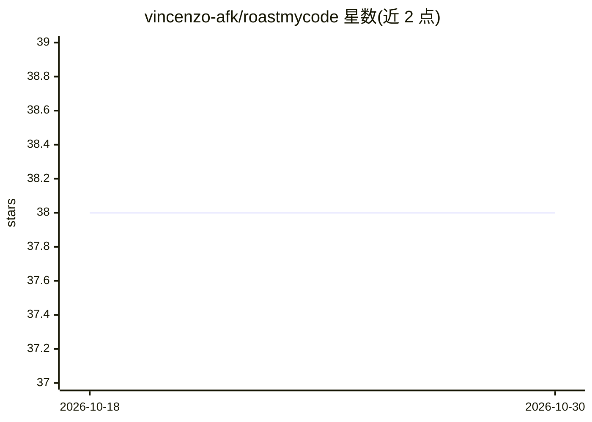

# vincenzo-afk/roastmycode

⭐ 38 · HTML · 推送 2026-08-23 · [GitHub](https://github.com/vincenzo-afk/roastmycode) · [官网](https://roastmycode-lemon.vercel.app) · 个人维护

**AI 代码吐槽与重构工具：粘贴代码获得趣味点评和重构**

基于浏览器的开发者工具：用户粘贴代码片段，经服务端 Groq 代理（llama-3.3-70b-versatile）生成结构化吐槽反馈，包含人格化点评、代码质量指标、十项 pain_score、最差诊断、commit 建议与最终判定；另提供紧急重构流程，返回重构后代码、损伤评估与修复清单。支持 8 种吐槽人格与 10 种语言，本地 localStorage 记录 Hall of Shame。限制：无许可证文件、无自动化浏览器测试，静态托管无法运行 API 函数。

## 筛选速览

| 维度 | 判定 | 备注 |
|---|---|---|
| AI 角色 | `ai-native` | 本体是模型或模型工具 |
| 许可风险 | `none` | — |
| 部署形态 | `library` | 以包/库形式分发 |
| 模型依赖 | locked-api |  |
| 硬件要求 | — | 无带数字的原话,不猜 |
| 安装摩擦 | `low` | 无编译、无系统依赖或容器化 |
| 成熟度 | — | 结构信号不足 |

## 能力要点

- 8 种吐槽人格（Funny/Gordon Ramsay/Shakespeare 等）流式输出结构化结果
- 紧急重构流程返回重构代码与损伤评估
- 服务端 Groq 代理使 API key 不进入浏览器代码
- 10 种编程语言支持与自动语言检测

## 适用场景

- 以趣味方式获得代码反馈并生成可分享的吐槽卡片
- 快速获得代码重构建议与修复清单
- 为 commit 生成有记忆点的提交信息建议

## 场景标签

`代码审查` · 领域:编码与开发

## 证据(README 行号)

> L21: ROASTMYCODE is a browser-based developer tool that turns a submitted code sample into a structured AI code roast. I
> L148: |`POST`|`/api/roast`|Generate a structured roast using the selected persona|Proxied `text/event-stream` response|

## 星数曲线

2026-10-18 38 → 2026-10-30 38（+0）

---
*卡片 v1 · prompt 1.4 · 生成 2026-10-25 · 置信度 mid · 依据 README sha `22f9af56787b` · [字段定义](../../DATASET.md)*
