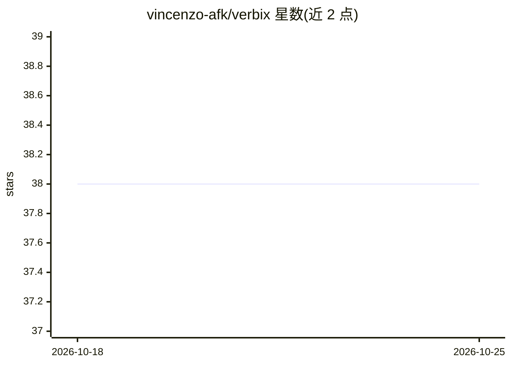

# vincenzo-afk/verbix

⭐ 38 · TypeScript · MIT · 推送 2026-08-27 · [GitHub](https://github.com/vincenzo-afk/verbix) · 个人维护

**全栈 AI 提示词工作台：发现、编写、共享与运行可复用提示词**

基于 React + Express + tRPC + Drizzle/MySQL 的提示词平台：访客可按分类、标签、模型兼容性浏览公共提示词；认证用户可编写含 {{variable}} 变量的提示词并保留版本，通过服务端 AI 适配器（free-chatbot）改进提示词且不覆盖原稿，还可将自有提示词部署为可分享的 agent；管理员负责审核、举报、分类与导入源策略管理。导入功能仅处理经管理员批准域名的公开 URL，遵循 robots.txt 并保留署名。本地运行需配置数据库、OAuth 等环境变量。

## 筛选速览

| 维度 | 判定 | 备注 |
|---|---|---|
| AI 角色 | `ai-ecosystem` | LLM/agent 周边工具 |
| 许可风险 | `permissive` | MIT |
| 部署形态 | `library` | 以包/库形式分发 |
| 模型依赖 | — | README 未给出锁定关系 |
| 硬件要求 | — | 无带数字的原话,不猜 |
| 安装摩擦 | `low` | 无编译、无系统依赖或容器化 |
| 成熟度 | — | 结构信号不足 |

## 能力要点

- 提示词编写含 {{variable}} 类型化变量、实时预览与版本历史
- 服务端 AI 适配器改进提示词，原稿与改进稿并行保存
- 将自有提示词部署为可分享 agent，含按小时访客限流
- 管理员审核体系与遵循 robots.txt 的权利感知导入流程

## 适用场景

- 团队沉淀、发现和复用结构化提示词
- 把常用提示词发布为带变量表单的 agent 供他人调用
- 对公共提示词库做审核与版权合规管理

## 场景标签

`提示工程` · 领域:Agent 开发

## 证据(README 行号)

> L3: > A full-stack workspace for discovering, structuring, versioning, sharing, and running reusable AI prompts.
> L13: Verbix makes reusable prompt work discoverable and manageable. Visitors can browse public prompts by category, tag,

## 星数曲线

2026-10-18 38 → 2026-10-25 38（+0）

---
*卡片 v1 · prompt 1.4 · 生成 2026-10-25 · 置信度 mid · 依据 README sha `38cce5056818` · [字段定义](../../DATASET.md)*
