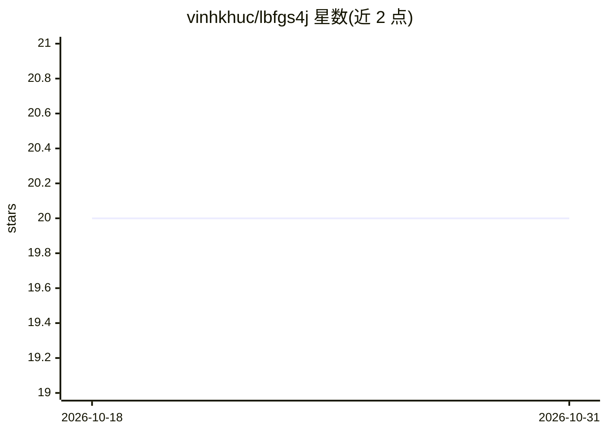

# vinhkhuc/lbfgs4j

⭐ 20 · Java · MIT · 推送 2026-05-17 · [GitHub](https://github.com/vinhkhuc/lbfgs4j) · 个人维护

**liblbfgs 的 Java 移植：L-BFGS/OWL-QN 无约束优化库**

将 C 库 liblbfgs 直接移植为 Java，提供 L-BFGS 方法求解无约束最小化问题（f(x) 及梯度可计算即可），并包含 OWL-QN 实现，用于最小化 f(x)+C|x| 形式的 L1 正则目标。通过 Maven 依赖引入，以 LbfgsMinimizer 类调用，可设置记忆大小、最大迭代次数等参数。面向需要在 Java 中做数值优化的开发与科研用户，MIT 许可。

## 筛选速览

| 维度 | 判定 | 备注 |
|---|---|---|
| AI 角色 | `ai-native` | 本体是模型或模型工具 |
| 许可风险 | `permissive` | MIT |
| 部署形态 | `None` |  |
| 模型依赖 | — | README 未给出锁定关系 |
| 硬件要求 | — | 无带数字的原话,不猜 |
| 安装摩擦 | `low` | 无编译、无系统依赖或容器化 |
| 成熟度 | — | 结构信号不足 |

## 能力要点

- L-BFGS 无约束最小化求解
- OWL-QN 方法支持 L1 正则项 f(x)+C|x|
- Maven 依赖发布（0.2.1），LbfgsMinimizer 类 API
- 可配置记忆大小、最大迭代次数等参数

## 适用场景

- 在 Java 项目中做无约束数值优化
- 求解带 L1 正则的机器学习目标函数
- 替代 C 版 liblbfgs 在 JVM 环境下的使用

## 场景标签

 · 领域:机器学习/数值优化

## 证据(README 行号)

> L1: This is a direct Java port of liblbfgs, a library of Limited-memory Broyden-Fletcher-Goldfarb-Shanno (L-BFGS) .
> L3: The L-BFGS optimization method is used to solve unconstrained minimization problem:
> L10: This library also includes the implementation of the Orthant-Wise Limited-memory Quasi-Newton (OWL-QN) method which

## 星数曲线

2026-10-18 20 → 2026-10-31 20（+0）

---
*卡片 v1 · prompt 1.4 · 生成 2026-10-28 · 置信度 mid · 依据 README sha `0e5873bb4221` · [字段定义](../../DATASET.md)*
