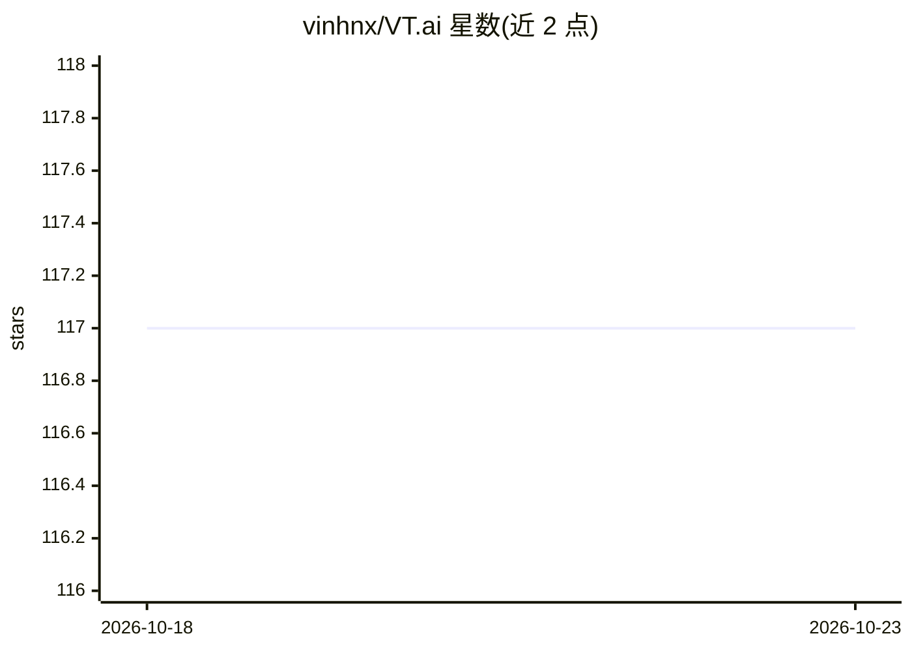

# vinhnx/VT.ai

⭐ 117 · Python · MIT · 推送 2026-10-21 · [GitHub](https://github.com/vinhnx/VT.ai) · [官网](https://vinhnx.github.io/VT.ai/) · 个人维护

**多模态 AI 聊天应用：语义路由自动选模型，支持多家提供商**

开源多模态 AI 聊天应用，面向终端用户，基于 Chainlit 构建。核心机制是基于向量的语义路由（FastEmbed 嵌入），按查询意图自动选择模型，无需手动切换。支持 OpenAI、Anthropic、Gemini、DeepSeek、Cohere、Ollama/llmman 本地模型等多提供商。能力覆盖文本聊天、图像生成（DALL-E 3/GPT-Image-1）、视觉分析、语音交互、Tavily 网络搜索与 `<think>` 推理可视化。安装途径含原生安装脚本、pip 与源码，API key 本地存储、默认无遥测。

## 筛选速览

| 维度 | 判定 | 备注 |
|---|---|---|
| AI 角色 | `ai-native` | 本体是模型或模型工具 |
| 许可风险 | `permissive` | MIT |
| 部署形态 | `library` | 以包/库形式分发 |
| 模型依赖 | local-ok | 支持本地模型 |
| 硬件要求 | — | 无带数字的原话,不猜 |
| 安装摩擦 | `low` | 无编译、无系统依赖或容器化 |
| 成熟度 | — | 结构信号不足 |

## 能力要点

- FastEmbed 向量语义路由自动选择模型
- 多提供商统一接入：OpenAI/Anthropic/Gemini/DeepSeek/Ollama 等
- 多模态：图像生成、视觉分析、语音交互、网络搜索
- API key 本地存储，默认无遥测与数据收集

## 适用场景

- 用一个界面与多家 LLM 提供商对话
- 让应用按问题类型自动路由到合适模型
- 在聊天中生成图像、分析上传图片、联网检索

## 场景标签

 · 领域:LLM 应用/聊天助手

## 证据(README 行号)

> L3: VT.ai is an open-source multimodal AI chat application with dynamic conversation routing. Supports multiple LLM prov
> L81: VT.ai uses vector-based semantic routing to automatically direct queries to the most appropriate model:

## 星数曲线

2026-10-18 117 → 2026-10-23 117（+0）

---
*卡片 v1 · prompt 1.4 · 生成 2026-10-23 · 置信度 high · 依据 README sha `e80f98045255` · [字段定义](../../DATASET.md)*
