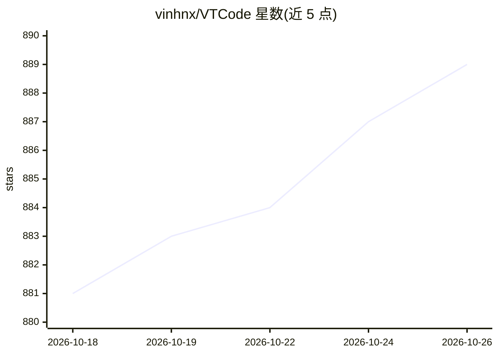

# vinhnx/VTCode

⭐ 889 · Rust · Apache-2.0 · 推送 2026-10-25 · [GitHub](https://github.com/vinhnx/VTCode) · [官网](https://vtcode.vinhnx.chatgpt.site/) · 个人维护

**面向终端的开源 Rust 编码 agent：规划、修改与审查代码**

用 Rust 编写的终端编码 agent，提供交互式 TUI 与无头 exec/ask/review 命令，用于探索代码库、规划并审查变更、执行工具调用。支持托管或本地模型供应商，密钥存入 OS keyring 或加密文件。机制上包含 HOVER 自纠错循环、可审计的命令策略与沙箱、会话压缩与恢复、定时任务，以及 MCP、Agent Skills、插件与编辑器桥接等集成。安装方式为安装脚本、Homebrew 或 Cargo（Rust 1.98.1+），Windows 产物为 best-effort。

## 筛选速览

| 维度 | 判定 | 备注 |
|---|---|---|
| AI 角色 | `ai-ecosystem` | LLM/agent 周边工具 |
| 许可风险 | `permissive` | Apache-2.0 |
| 部署形态 | `library` | 以包/库形式分发 |
| 模型依赖 | — | README 未给出锁定关系 |
| 硬件要求 | — | 无带数字的原话,不猜 |
| 安装摩擦 | `low` | 无编译、无系统依赖或容器化 |
| 成熟度 | — | 结构信号不足 |

## 能力要点

- 交互式 TUI 与无头 exec/ask/review 三种运行模式
- HOVER 循环：工具证据不匹配时带修正参数重试
- 命令策略审计、沙箱与 full_auto 工作区信任机制
- 会话压缩与恢复、定时任务、MCP/Skills/插件/编辑器桥接

## 适用场景

- 在终端里让 agent 规划并实施代码重构，审查 turn diff 后提交
- 无头模式跑自动化编码任务并恢复历史会话
- 通过 MCP、Skills 与插件扩展 agent 能力

## 场景标签

`编码 Agent` `代码审查` · 领域:编码与开发

## 证据(README 行号)

> L5: **An open-source coding agent for your terminal.**
> L7: Plan, build, and review with hosted or local models, sandboxed tools, and resumable sessions.
> L27: Use the interactive TUI or `vtcode exec` to explore a codebase, plan and review changes, and run tools. Choose a

## 星数曲线

2026-10-18 881 → 2026-10-26 889（+8）

---
*卡片 v1 · prompt 1.4 · 生成 2026-10-21 · 置信度 high · 依据 README sha `5f7ea4840e51` · [字段定义](../../DATASET.md)*
