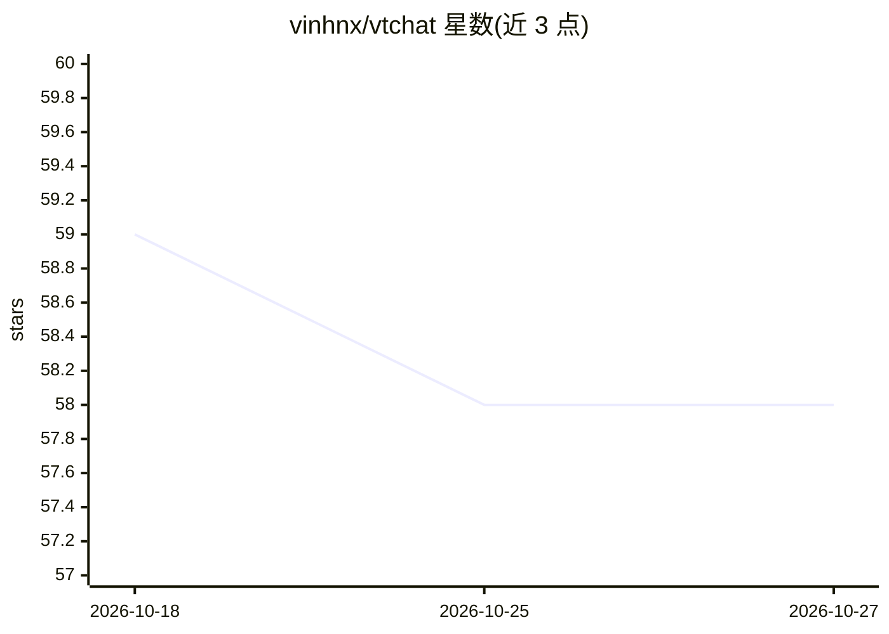

# vinhnx/vtchat

⭐ 58 · TypeScript · MIT · 推送 2026-10-21 · [GitHub](https://github.com/vinhnx/vtchat) · 个人维护

**面向用户的隐私优先 AI 聊天应用，支持多模型与本地运行**

基于 Next.js 15 / React 19 / TypeScript 的 Web 端 AI 聊天应用，面向终端用户：支持 OpenAI、Anthropic、Google、Fireworks、Together AI、xAI 等云端模型及 Ollama、LM Studio 本地模型，自带 9 个免费服务器模型与 BYOK 模式。功能含文档处理（PDF/DOC 等 10MB 内）、网页搜索、结构化 JSON 抽取、图表生成、思考模式与对话式图像编辑（Nano Banana）。会话数据存于浏览器 IndexedDB，服务器不存聊天记录；提供 Docker Compose 与 Bun 手动两种自托管部署方式。

## 筛选速览

| 维度 | 判定 | 备注 |
|---|---|---|
| AI 角色 | `ai-native` | 本体是模型或模型工具 |
| 许可风险 | `permissive` | MIT |
| 部署形态 | `self-host` | docker 或自建部署 |
| 模型依赖 | local-ok | 支持本地模型 |
| 硬件要求 | — | 无带数字的原话,不猜 |
| 安装摩擦 | `low` | 无编译、无系统依赖或容器化 |
| 成熟度 | — | 结构信号不足 |

## 能力要点

- 多 AI 提供商支持（OpenAI/Anthropic/Google/Fireworks/Together/xAI）加 Ollama、LM Studio 本地模型
- 本地优先存储：会话存于浏览器 IndexedDB，服务器零聊天存储
- 文档处理、网页搜索、结构化抽取、图表生成与思考模式
- 对话式图像编辑器 Nano Banana

## 适用场景

- 日常多模型 AI 聊天与文档问答
- 用自有 API key（BYOK）免费使用高级模型
- 通过 Ollama/LM Studio 在本机私有运行模型
- 自托管一个不落盘聊天记录的 AI 聊天服务

## 场景标签

`聊天机器人` `文档问答` · 领域:对话与助手

## 证据(README 行号)

> L17: VT is a production-ready, privacy-focused AI chat application delivering cutting-edge AI capabilities through an ex
> L50: - **Premium AI Models (Free with BYOK)**: Claude Sonnet 4.5, Claude 4 Sonnet/Opus, GPT-4.1, O3/O3 Mini/O4 Mini, O1 
> L64: - **Local-First Storage**: All chat data stored in browser's IndexedDB via Dexie.js

## 星数曲线

2026-10-18 59 → 2026-10-27 58（-1）

---
*卡片 v1 · prompt 1.4 · 生成 2026-10-24 · 置信度 high · 依据 README sha `eee764f29edc` · [字段定义](../../DATASET.md)*
