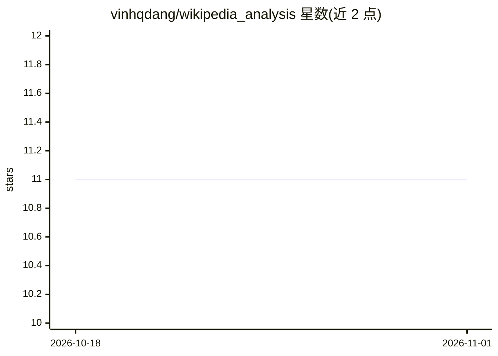

# vinhqdang/wikipedia_analysis

⭐ 11 · Python · GPL-2.0 · 推送 2026-10-05 · [GitHub](https://github.com/vinhqdang/wikipedia_analysis) · 个人维护

**用多种机器学习方法预测维基百科条目质量等级的 R 代码库**

个人研究代码仓库，基于约 2 万篇维基百科条目的数据集（all_data.tsv），用 R 实现多种算法预测条目质量等级：线性回归、CART、kNN、多项式逻辑回归、SVM、随机森林（含带/不带可读性分数两种，5 折交叉验证），并提供 RMSE、NDCG 等工具函数。运行需 R 环境（在 R 3.2.3 测试），依赖 caTools、rpart、class、h2o 等包，通过 source 脚本加载后调用各 run* 函数。

## 筛选速览

| 维度 | 判定 | 备注 |
|---|---|---|
| AI 角色 | `ai-native` | 本体是模型或模型工具 |
| 许可风险 | `viral` | GPL-2.0 |
| 部署形态 | `None` |  |
| 模型依赖 | — | README 未给出锁定关系 |
| 硬件要求 | — | 无带数字的原话,不猜 |
| 安装摩擦 | `low` | 无编译、无系统依赖或容器化 |
| 成熟度 | — | 结构信号不足 |

## 能力要点

- 实现 6 类模型：线性回归、CART、kNN、多项逻辑回归、SVM、随机森林
- 随机森林提供带/不带可读性分数两种变体，5 折交叉验证
- 附带约 2 万篇条目的数据集与 RMSE/NDCG 工具函数

## 适用场景

- 复现或学习维基百科条目质量预测的多种基线方法
- 在自带数据集上比较不同分类算法效果
- 研究可读性分数对质量预测的影响

## 场景标签

 · 领域:文本挖掘/机器学习研究

## 证据(README 行号)

> L3: This repository contains my code to predict quality class of Wikipedia articles.
> L61: We provided two functions for *randomForest* model.

## 星数曲线

2026-10-18 11 → 2026-11-01 11（+0）

---
*卡片 v1 · prompt 1.4 · 生成 2026-11-01 · 置信度 high · 依据 README sha `6321b315e17b` · [字段定义](../../DATASET.md)*
