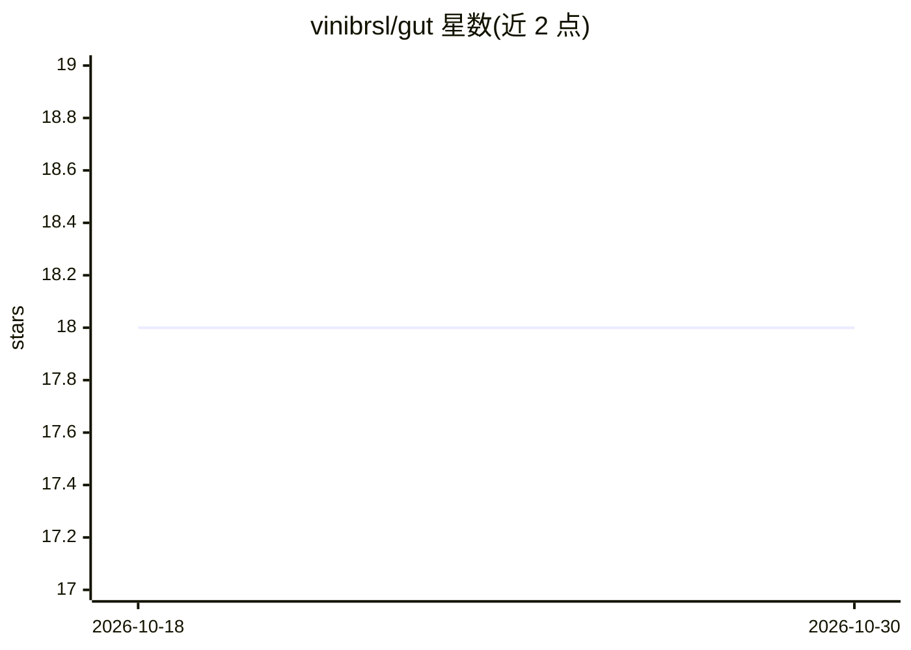

# vinibrsl/gut

⭐ 18 · Elixir · Apache-2.0 · 推送 2026-10-09 · [GitHub](https://github.com/vinibrsl/gut) · [官网](https://gut.hexdocs.pm) · 个人维护

**Elixir DSL：用 LLM 判断在控制流中选值**

面向 Elixir 开发者的 Hex 包，提供 Gut.feel/4 DSL：传入 subject、question 和候选值（列表/关键字/整数范围），由 LLM 判断并返回选中的 Elixir 值，无需 agent 框架。适配器机制支持 Jev 评估模型、ReqLLM 任意模型（含 Ollama 本地模型）及自定义实现（如 Bumblebee）。struct 可 derive Gut.Subject 限定发送字段；内置无 LLM 请求的测试适配器与 :telemetry 事件。要求 Elixir 1.18+。

## 筛选速览

| 维度 | 判定 | 备注 |
|---|---|---|
| AI 角色 | `ai-ecosystem` | LLM/agent 周边工具 |
| 许可风险 | `permissive` | Apache-2.0 |
| 部署形态 | `None` |  |
| 模型依赖 | local-ok | 支持本地模型 |
| 硬件要求 | — | 无带数字的原话,不猜 |
| 安装摩擦 | `low` | 无编译、无系统依赖或容器化 |
| 成熟度 | — | 结构信号不足 |

## 能力要点

- Gut.feel/4 以列表/关键字/整数范围为候选，返回 Elixir 值
- 适配器架构：Jev、ReqLLM 任意模型、Ollama 本地模型、自定义 adapter
- Gut.Test 提供 stub 化测试，支持 async: true，不发 LLM 请求
- 发出 :telemetry 事件并排除主体内容等敏感数据

## 适用场景

- 邮件是否为垃圾邮件的 LLM 分拣
- 工单按内容路由到对应团队
- 用 1-5 分值评估客户情绪并触发人工复核

## 场景标签

 · 领域:LLM 基础设施/Elixir 开发库

## 证据(README 行号)

> L5: Gut is a simple DSL for LLM decisions in Elixir. It picks an Elixir value for your subject and question. No agent fr
> L71: An adapter connects Gut to a decision system. Gut passes it the subject, question, and choices. The adapter returns

## 星数曲线

2026-10-18 18 → 2026-10-30 18（+0）

---
*卡片 v1 · prompt 1.4 · 生成 2026-10-29 · 置信度 high · 依据 README sha `8c2f08db8797` · [字段定义](../../DATASET.md)*
