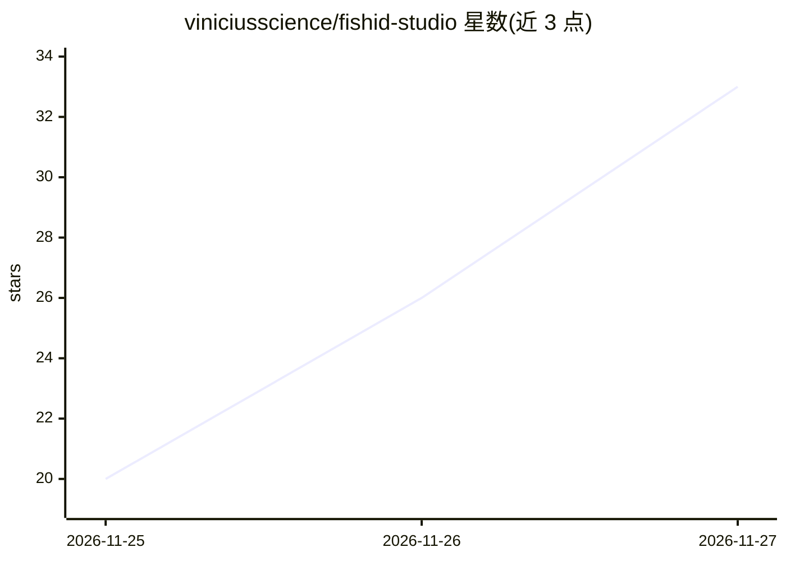

# viniciusscience/fishid-studio

⭐ 33 · Python · MIT · 推送 2026-11-26 · [GitHub](https://github.com/viniciusscience/fishid-studio) · [官网](https://doi.org/10.5281/zenodo.24451918) · 组织维护

**面向科研与渔业的海水鱼种自动识别与视频生物测量平台**

源自 UNIVALI 应用计算硕士研究的开源计算机视觉平台：基于 Keras ConvNeXt-Tiny 模型识别 10 种大型洄游海水鱼（6,200+ 图像训练），输出俗名、学名与 Top-3 概率；通过 YOLO-World+SAM 2.1 自动分割、ByteTrack 多目标追踪实现电子监控（EM）场景下的个体计数、体长测量（px↔cm 标定）与误差估计；前端为 Streamlit+PixiJS v8 的 WebGL 水族馆界面，后端 FastAPI，经 .env 配置本地/S3/GCS 存储后端，Docker 部署。模型结果定位为科研决策辅助，不替代官方分类报告。

## 筛选速览

| 维度 | 判定 | 备注 |
|---|---|---|
| AI 角色 | `ai-native` | 本体是模型或模型工具 |
| 许可风险 | `permissive` | MIT |
| 部署形态 | `self-host` | docker 或自建部署 |
| 模型依赖 | — | README 未给出锁定关系 |
| 硬件要求 | — | 无带数字的原话,不猜 |
| 安装摩擦 | `low` | 无编译、无系统依赖或容器化 |
| 成熟度 | — | 结构信号不足 |

## 能力要点

- ConvNeXt-Tiny 分类 10 种洄游鱼类，含 Top-3 概率与 Grad-CAM 可解释性
- EM 管线：ByteTrack 计数、SAM 2.1 脊柱曲线体长测量与 ±% 误差估计
- Streamlit+PixiJS v8 WebGL 水族馆界面，支持手机相机拍摄上传
- 可持续学习模块按清晰度/亮度/对比度过滤并区分人工复核照片

## 适用场景

- 对渔船甲板视频做电子监控审核与个体计数
- 野外用手机拍照快速识别大型洄游鱼种
- 科研场景下标注追踪轨迹并生成 YOLO 自动标签

## 场景标签

`科研工具` `目标检测` `图像视频处理` · 领域:学习与行业

## 证据(README 行号)

> L24: **FishID Studio** é uma plataforma aberta de visão computacional voltada à **identificação automatizada de grandes 
> L28: Identificação inteligente de **10 grandes espécies pelágicas migratórias** (atuns, agulhões, espadarte e dourado-do
> L83: - **📊 Monitoramento Eletrônico (EM) — Contagem & Biometria:** aba dedicada no FishID Studio para auditar vídeos lon

## 星数曲线

2026-11-25 20 → 2026-11-27 33（+13）

---
*卡片 v1 · prompt 1.4 · 生成 2026-11-24 · 置信度 high · 依据 README sha `c68d2912f9f5` · [字段定义](../../DATASET.md)*
