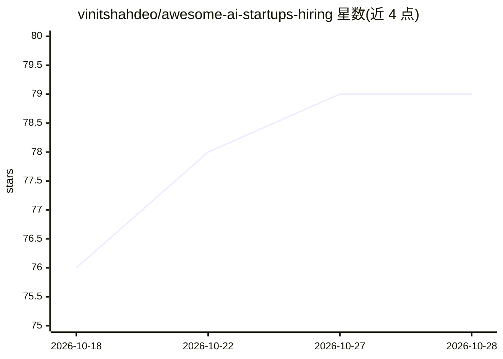

# vinitshahdeo/awesome-ai-startups-hiring

⭐ 80 · 推送 2026-09-14 · [GitHub](https://github.com/vinitshahdeo/awesome-ai-startups-hiring) · [官网](https://peerlist.io/vinitshahdeo/project/awesome-ai-startups-hiring-in-2026) · 个人维护

**160+ AI 创业公司招聘与融资信息策展清单，面向求职工程师**

个人维护的 awesome 类清单，收录 160+ 家 AI 创业公司，按 AI 基础设施/LLM 推理、AI 开发者工具、数据与检索基础设施、AI 安全、语音、AI 金融科技等类别组织，每条列出公司、类别与最新融资信息。面向求职的软件工程师，附带公司评估框架与面试准备指南链接，社区通过 PR 持续更新。README 明确警告：融资数据由 AI 挖掘、未经独立复核，使用前需自行核查。

## 筛选速览

| 维度 | 判定 | 备注 |
|---|---|---|
| AI 角色 | `ai-knowledge` | 知识聚合/清单类 |
| 许可风险 | `none` | — |
| 部署形态 | `None` |  |
| 模型依赖 | — | README 未给出锁定关系 |
| 硬件要求 | — | 无带数字的原话,不猜 |
| 安装摩擦 | `low` | 无编译、无系统依赖或容器化 |
| 成熟度 | — | 结构信号不足 |

## 能力要点

- 160+ 家 AI 创业公司按类别组织并附融资信息
- 提供公司选择评估框架与面试准备指南
- 社区 PR 驱动持续更新（标注最后更新日期）
- 明确声明融资数据未经独立复核

## 适用场景

- 求职者浏览获资 AI 公司并直达其 /careers 页面
- 评估目标创业公司的技术栈与融资状况
- 准备招聘经理轮次的面试问题

## 场景标签

`精选清单` · 领域:学习与行业

## 证据(README 行号)

> L7: A curated list of 160+ AI-first startups across agent infrastructure, LLM inference, AI dev tools, data & retrieval 
> L28: |#|Company|Category|Funding Details|

## 星数曲线

2026-10-18 76 → 2026-10-28 79（+3）

---
*卡片 v1 · prompt 1.4 · 生成 2026-10-24 · 置信度 high · 依据 README sha `331926f78bc6` · [字段定义](../../DATASET.md)*
