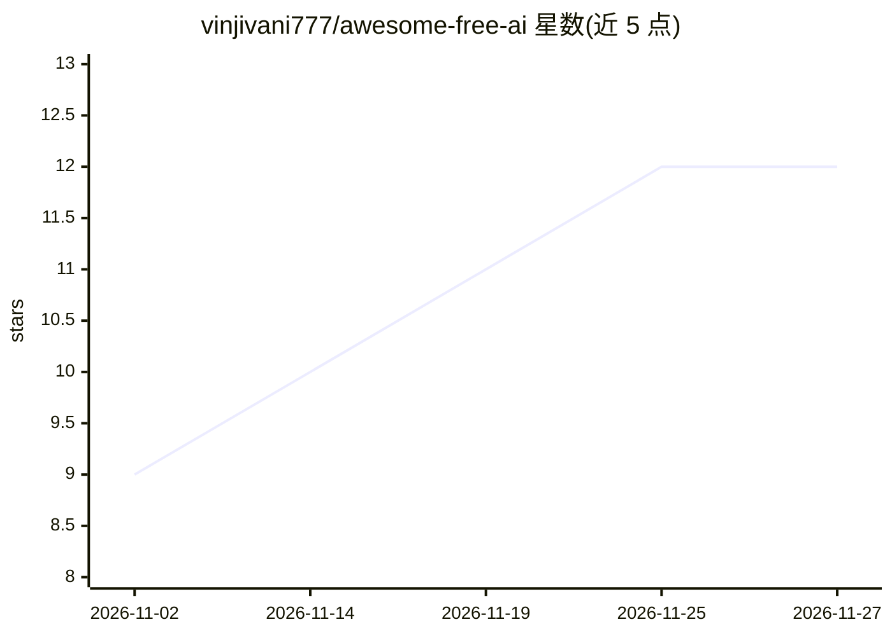

# vinjivani777/awesome-free-ai

⭐ 12 · 推送 2026-11-23 · [GitHub](https://github.com/vinjivani777/awesome-free-ai) · [官网](https://www.freeairepo.com) · 个人维护 · 中文 README

**免费开源自托管 AI 工具策展清单：标注安装难度/商用许可/硬件**

一份按类别组织的免费开源 AI 工具聚合清单，收录 LLM 与聊天、Agent 与自动化、编码助手、RAG 与搜索等类别的仓库条目，每条附星数、安装难度、能否商用产出（代码与模型许可）与运行平台（如 Mac/无 GPU）。另提供付费工具的开源替代对照表（ChatGPT、Midjourney、Cursor 等）及每周上升榜，配套网站 freeairepo.com 提供可筛选检索，仅收录仍在活跃维护的项目。

## 筛选速览

| 维度 | 判定 | 备注 |
|---|---|---|
| AI 角色 | `ai-knowledge` | 知识聚合/清单类 |
| 许可风险 | `none` | — |
| 部署形态 | `None` |  |
| 模型依赖 | — | README 未给出锁定关系 |
| 硬件要求 | — | 无带数字的原话,不猜 |
| 安装摩擦 | `medium` | 含编译或系统依赖之一 |
| 成熟度 | — | 结构信号不足 |

## 能力要点

- 每个条目标注安装难度（Easy/Medium/Hard）
- 标注能否商用产出与代码/模型许可限制
- 标注运行平台（Mac、无 GPU 等）
- 付费 AI 工具的开源替代对照表

## 适用场景

- 想自托管免费替代方案来替换付费 AI 订阅
- 按安装难度和硬件条件挑选可本地运行的工具
- 查找某类场景（RAG/编码助手/Agent）的开源选项

## 场景标签

`精选清单` `RAG` · 领域:知识与检索

## 证据(README 行号)

> L1: # Awesome Free AI
> L3: Free, open-source AI tools you can run yourself, with what most lists leave out: **how hard each one is to set up**,
> L66: |Repo|What it does|Stars|Setup|Sell what you build?|Runs on|

## 星数曲线

2026-11-02 9 → 2026-11-27 12（+3）

---
*卡片 v1 · prompt 1.4 · 生成 2026-11-19 · 置信度 high · 依据 README sha `959255f218d9` · [字段定义](../../DATASET.md)*
