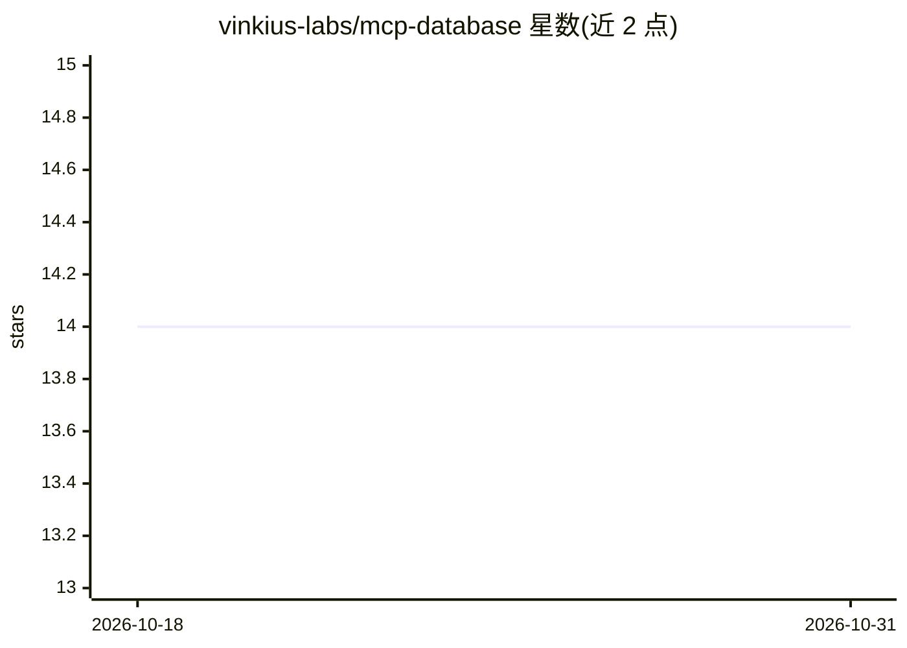

# vinkius-labs/mcp-database

⭐ 14 · 推送 2026-10-09 · [GitHub](https://github.com/vinkius-labs/mcp-database) · [官网](https://vinkius.com) · 组织维护

**MCP 连接器开放数据目录：11,088 个连接器元数据**

Vinkius 公司维护的开放数据仓库，自动同步其连接器目录：收录 11,088 个连接器（MCP server）的元数据，按 300 余个类别组织（productivity 1899、finance 1233、developer-tools 695 等），覆盖生产力、金融、工程、健康等领域。数据由 Vinkius Registry Sync 自动生成，用于发现与集成面向 AI agent 的连接器，目录可在 vinkius.com 浏览，云端运行经 cloud.vinkius.com。README 未提供本仓库的安装运行说明，主体是分类清单。

## 筛选速览

| 维度 | 判定 | 备注 |
|---|---|---|
| AI 角色 | `ai-knowledge` | 知识聚合/清单类 |
| 许可风险 | `none` | — |
| 部署形态 | `None` |  |
| 模型依赖 | — | README 未给出锁定关系 |
| 硬件要求 | — | 无带数字的原话,不猜 |
| 安装摩擦 | `low` | 无编译、无系统依赖或容器化 |
| 成熟度 | — | 结构信号不足 |

## 能力要点

- 收录 11,088 个连接器，元数据自动更新
- 300 余个类别组织（productivity/finance/developer-tools 等）
- 条目面向 Claude、Cursor 及自定义 agent 的集成
- 由 Vinkius Registry Sync 自动生成

## 适用场景

- 查找可接入 AI agent 的 MCP 连接器
- 按业务领域浏览连接器覆盖范围
- 为企业 AI agent 部署筛选连接器

## 场景标签

`精选清单` · 领域:学习与行业

## 证据(README 行号)

> L3: Welcome to the **Vinkius Open Data Initiative**. This repository provides open access to the Vinkius connector catal
> L5: This dataset is meticulously sourced from the Vinkius connector catalog — a curated, enterprise-grade marketplace of

## 星数曲线

2026-10-18 14 → 2026-10-31 14（+0）

---
*卡片 v1 · prompt 1.4 · 生成 2026-10-31 · 置信度 high · 依据 README sha `88b3ad2851f7` · [字段定义](../../DATASET.md)*
