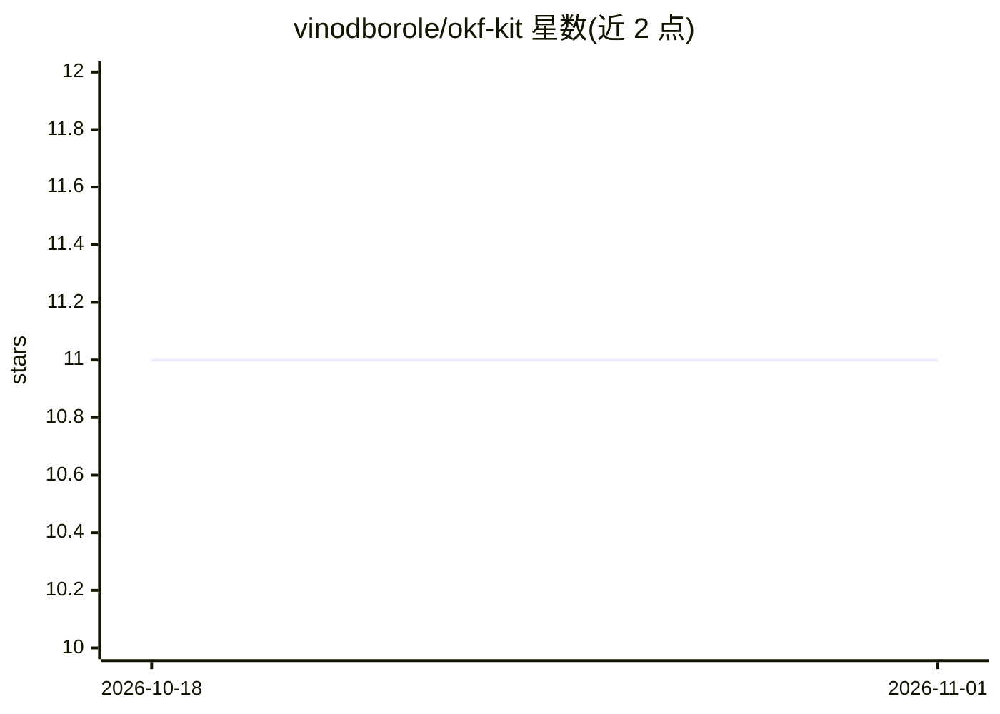

# vinodborole/okf-kit

⭐ 11 · Python · Apache-2.0 · 推送 2026-07-15 · [GitHub](https://github.com/vinodborole/okf-kit) · [官网](https://vinodborole.github.io/okf-kit/) · 个人维护

**把任意网站转为可移植的 OKF 知识包，供 agent 阅读与离线问答**

okf-kit 是一个 Python CLI 库：对网站做域内限定爬取，生成符合 Google Open Knowledge Format 的 markdown 知识包（带 YAML frontmatter 的概念文件与目录级 index.md），agent 可用纯文件读取方式导航。提供增量 sync、可视化、MCP 服务（供 Claude Code/Cursor 等 MCP 客户端读取）、社区 registry 与本地 HTTP API。构建路径无需 LLM 与 API key，okf chat 可选接入 OpenAI/Ollama/vLLM/OpenRouter/Claude，或走零 key 检索回答；为 Google OKF 的独立非官方实现。

## 筛选速览

| 维度 | 判定 | 备注 |
|---|---|---|
| AI 角色 | `ai-ecosystem` | LLM/agent 周边工具 |
| 许可风险 | `permissive` | Apache-2.0 |
| 部署形态 | `self-host` | docker 或自建部署 |
| 模型依赖 | local-ok | 支持本地模型 |
| 硬件要求 | — | 无带数字的原话,不猜 |
| 安装摩擦 | `low` | 无编译、无系统依赖或容器化 |
| 成熟度 | — | 结构信号不足 |

## 能力要点

- 确定性爬取生成 OKF bundle，构建路径零 API key、零模型调用
- okf sync 增量更新，git 中产生小 delta 提交
- stdio MCP 服务器将 bundle 供给 Claude Code/Cursor 等 MCP 客户端
- okf chat 支持 OpenAI/Ollama/OpenRouter/Claude 及零 key 检索回退（带引用）

## 适用场景

- 把项目文档站做成 agent 可读的本地知识包
- 通过 MCP 让 Claude Code/Cursor 读取项目最新文档
- 离线（Ollama）或零 key 检索方式与文档对话
- 发布与共享知识包并保持自动同步

## 场景标签

`网页抓取` `文档问答` `知识库管理` · 领域:效率与自动化

## 证据(README 行号)

> L13: `okf-kit` crawls a site into a
> L139: Exposes `list_bundles` / `list_directory` / `read_concept` / `search_bundle` over
> L223: Yes — `okf serve-mcp <bundle>` is a stdio MCP server exposing `list_bundles`,

## 星数曲线

2026-10-18 11 → 2026-11-01 11（+0）

---
*卡片 v1 · prompt 1.4 · 生成 2026-11-01 · 置信度 high · 依据 README sha `e033dbbb4467` · [字段定义](../../DATASET.md)*
