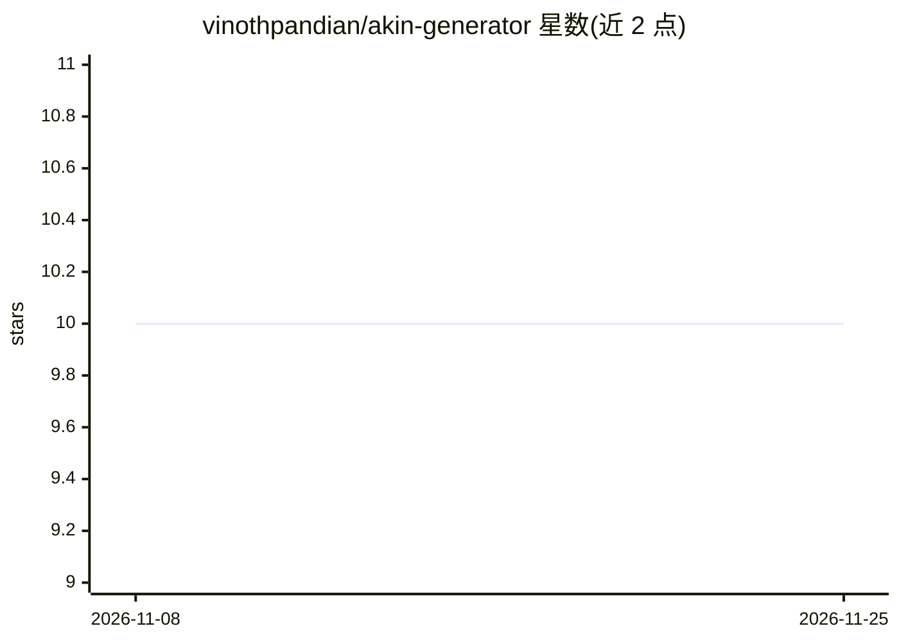

# vinothpandian/akin-generator

⭐ 10 · Python · MIT · 推送 2026-11-06 · [GitHub](https://github.com/vinothpandian/akin-generator) · 组织维护

**为设计师生成 UI 线框图的 GAN 模型工具**

Akin 是一个 UI 线框图生成器：设计者选择一个 UI 设计模式，工具基于微调后的 SAGAN（Self-Attention GAN）模型生成多个对应的 UI 线框图。模型使用 RICO 数据集的人工标注子集训练，覆盖 5 种 Android UI 设计模式、500 张线框图样本。代码基于 Leafinity 的 SAGAN 实现，使用 Python 3.7 与 Tensorflow 2.1，README 提供数据集下载、模型 checkpoint 下载、依赖安装与重新训练的步骤，另有在线文档链接。

## 筛选速览

| 维度 | 判定 | 备注 |
|---|---|---|
| AI 角色 | `ai-native` | 本体是模型或模型工具 |
| 许可风险 | `permissive` | MIT |
| 部署形态 | `library` | 以包/库形式分发 |
| 模型依赖 | — | README 未给出锁定关系 |
| 硬件要求 | — | 无带数字的原话,不猜 |
| 安装摩擦 | `low` | 无编译、无系统依赖或容器化 |
| 成熟度 | — | 结构信号不足 |

## 能力要点

- 基于微调 SAGAN 生成 UI 线框图
- 使用 RICO 数据集人工标注子集（5 种 Android 模式、500 张线框图）
- 支持下载训练 checkpoint 或用 python main.py --train 重新训练
- 提供在线 API 文档链接

## 适用场景

- 设计初期根据 UI 设计模式快速获得多个线框图
- 在 RICO 标注数据上重新训练生成模型
- 研究 GAN 在 UI 生成任务上的应用

## 场景标签

`图像生成` `微调` · 领域:内容生成

## 证据(README 行号)

> L18: > Akin is a UI wireframe generator that allows designers to chose a UI design pattern and provides them with multip
> L28: Akin uses Python 3.7 and Tensorflow 2.1.

## 星数曲线

2026-11-08 10 → 2026-11-25 10（+0）

---
*卡片 v1 · prompt 1.4 · 生成 2026-11-19 · 置信度 high · 依据 README sha `a19bb59ebe39` · [字段定义](../../DATASET.md)*
