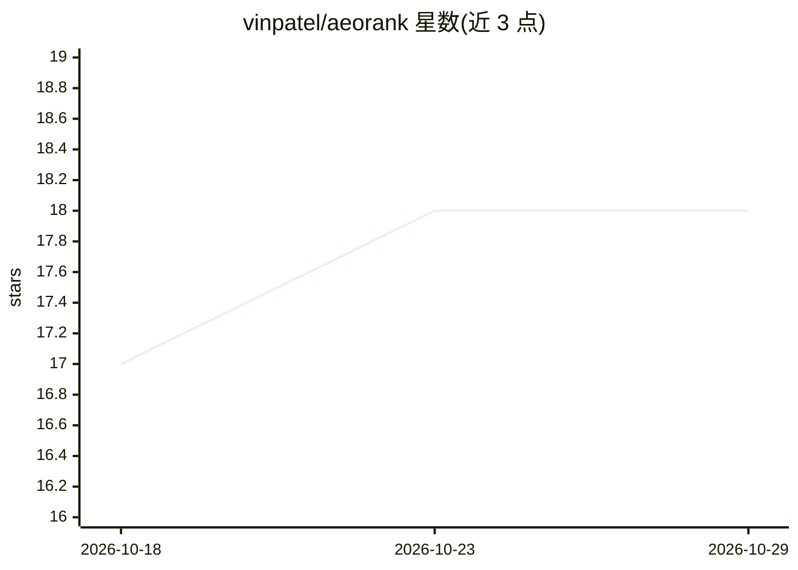

# vinpatel/aeorank

⭐ 18 · TypeScript · MIT · 推送 2026-10-28 · [GitHub](https://github.com/vinpatel/aeorank) · [官网](https://aeorank.dev) · 个人维护

**网站 AI 可见性扫描 CLI：12 维打分并生成 8 个 AI 可读文件**

面向网站开发者的 AEO（Answer Engine Optimization）工具：用 npx 运行 aeorank-cli 扫描任意 URL，按 12 个维度（高/中/低权重）给出 0–100 的爬虫可访问性与可提取性评分，并生成 llms.txt、llms-full.txt、CLAUDE.md、schema.json、robots-patch.txt 等 8 个文件。提供 GitHub Action（可因 GPTBot 等被 robots.txt 屏蔽而使 PR 失败）与 GitHub App 两种 CI 途径，另有 11 个框架插件（Next.js/Astro/Nuxt 等）与实验性托管面板（Pro $29）。CLI 无限次免费，面板有配额限制。

## 筛选速览

| 维度 | 判定 | 备注 |
|---|---|---|
| AI 角色 | `ai-ecosystem` | LLM/agent 周边工具 |
| 许可风险 | `permissive` | MIT |
| 部署形态 | `library` | 以包/库形式分发 |
| 模型依赖 | — | README 未给出锁定关系 |
| 硬件要求 | — | 无带数字的原话,不猜 |
| 安装摩擦 | `low` | 无编译、无系统依赖或容器化 |
| 成熟度 | `idea` | |

## 能力要点

- 12 维度评分（权重分 high/medium/low），0–100 分输出，支持 JSON 格式
- 生成 8 个 AI 可读文件（llms.txt、CLAUDE.md、schema.json 等）
- GitHub Action 可在 GPTBot/ClaudeBot/PerplexityBot/Google-Extended 被 robots.txt 屏蔽时使 PR 检查失败
- 11 个框架插件（Next.js/Astro/Nuxt/Remix/SvelteKit 等）一键生成同套文件

## 适用场景

- 在 CI 中对网站做 AI 爬虫可访问性检查并阻断配置回退
- 为站点生成 llms.txt 等供 LLM 爬虫读取的文件
- 检查并修复 robots.txt 中屏蔽 AI 爬虫的规则

## 场景标签

 · 领域:开发者工具/网站优化

## 证据(README 行号)

> L34: npx aeorank-cli@0.1.1 scan https://your-site.com
> L111: |`robots-patch.txt`|AI-specific robots.txt rules (GPTBot, ClaudeBot, PerplexityBot, Google-Extended)|
> L162: |`aeorank-cli`|CLI — `npx aeorank-cli@0.1.1 scan <url>`|

## 星数曲线

2026-10-18 17 → 2026-10-29 18（+1）

---
*卡片 v1 · prompt 1.4 · 生成 2026-10-29 · 置信度 high · 依据 README sha `3f6019547de0` · [字段定义](../../DATASET.md)*
