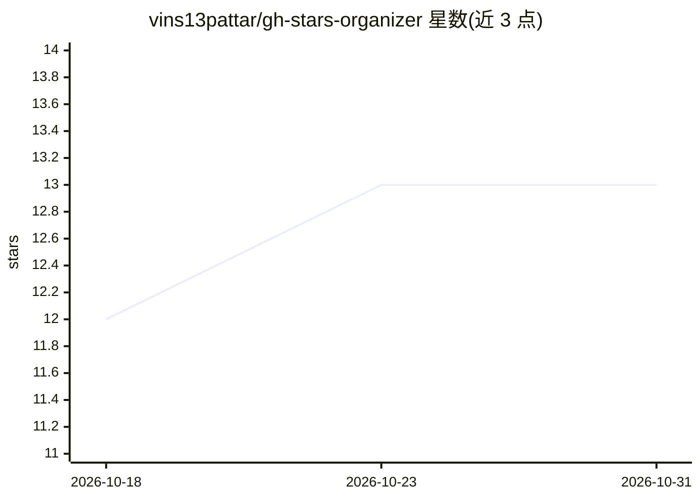

# vins13pattar/gh-stars-organizer

⭐ 13 · Python · MIT · 推送 2026-08-30 · [GitHub](https://github.com/vins13pattar/gh-stars-organizer) · [官网](https://vinodspattar.in/gh-stars-organizer/) · 个人维护

**用 LLM 与嵌入把 GitHub stars 整理成可检索知识库的 CLI 工具**

面向积累大量 star 的开发者的 Python CLI/终端 TUI 工具：分页拉取 GitHub starred 仓库，用 LLM 分类到工程类别，用嵌入构建语义搜索与相似度分组，再通过 GitHub User Lists GraphQL API 写入列表；列表 API 或 scope 不可用时回退生成本地分类列表。本地以 SQLite + FAISS 缓存，支持生成 stars-insights.md 洞察报告。需 Python 3.11+、已认证的 GitHub CLI；远程分类/嵌入需 OpenAI 兼容 API key，也可用本地回退。从源码安装。

## 筛选速览

| 维度 | 判定 | 备注 |
|---|---|---|
| AI 角色 | `ai-native` | 本体是模型或模型工具 |
| 许可风险 | `permissive` | MIT |
| 部署形态 | `library` | 以包/库形式分发 |
| 模型依赖 | — | README 未给出锁定关系 |
| 硬件要求 | — | 无带数字的原话,不猜 |
| 安装摩擦 | `low` | 无编译、无系统依赖或容器化 |
| 成熟度 | — | 结构信号不足 |

## 能力要点

- LLM 仓库分类 + 嵌入语义搜索与相似度分组
- 自动组织进 GitHub User Lists，含本地回退
- SQLite + FAISS 本地缓存避免重复计算
- 交互式 TUI 与 stars-insights.md 洞察报告

## 适用场景

- 把几百个 star 整理成分类清晰、可语义搜索的知识库
- 生成 star 趋势与清理建议报告
- 不想用 GitHub API 时在本地生成分好类的列表

## 场景标签

`语义搜索` · 领域:知识与检索

## 证据(README 行号)

> L5: It fetches your starred repositories, classifies them with an LLM, builds embedding-based similarity search, and org
> L17: - LLM-based repository classification into practical engineering categories
> L18: - Embedding-based semantic search and similarity grouping

## 星数曲线

2026-10-18 12 → 2026-10-31 13（+1）

---
*卡片 v1 · prompt 1.4 · 生成 2026-10-31 · 置信度 mid · 依据 README sha `341c7ca107eb` · [字段定义](../../DATASET.md)*
