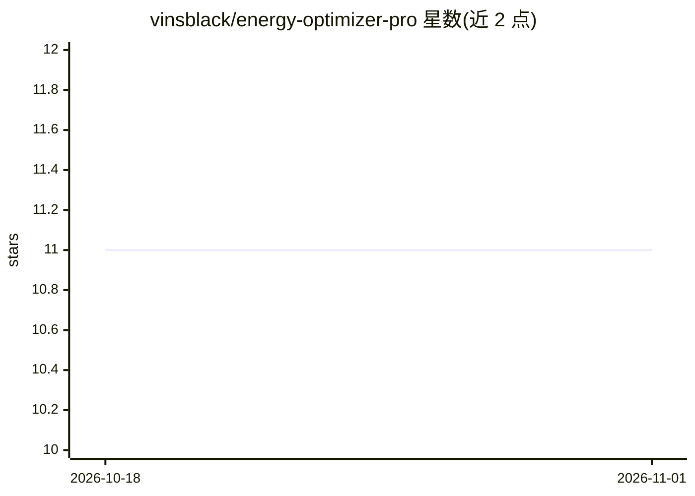

# vinsblack/energy-optimizer-pro

⭐ 11 · Python · NOASSERTION · 推送 2026-07-25 · [GitHub](https://github.com/vinsblack/energy-optimizer-pro) · 个人维护

**建筑能耗数据与 ML 优化的演示项目：训练模型并生成节能建议**

面向技术评估与实验的作品集/演示项目：用 Python 生成合成建筑能耗数据，基于 scikit-learn 兼容估计器做预处理与训练，支持 Random Forest、XGBoost、LightGBM 模型选择，输出预测与规则式优化建议，模型经 Joblib 持久化；提供 FastAPI 演示端点、Streamlit 与 Next.js 仪表盘源码及测试。README 明确声明非生产级服务，建议百分比为启发式估计，部分基础设施定义不完整（前端缺 package manifest、部分 Compose 服务引用缺失文件），Windows 检出受 Zone.Identifier 文件阻碍。

## 筛选速览

| 维度 | 判定 | 备注 |
|---|---|---|
| AI 角色 | `ai-native` | 本体是模型或模型工具 |
| 许可风险 | `none` | NOASSERTION |
| 部署形态 | `self-host` | docker 或自建部署 |
| 模型依赖 | — | README 未给出锁定关系 |
| 硬件要求 | — | 无带数字的原话,不猜 |
| 安装摩擦 | `low` | 无编译、无系统依赖或容器化 |
| 成熟度 | `idea` | |

## 能力要点

- Random Forest / XGBoost / LightGBM 模型选择与 Joblib 持久化
- FastAPI 演示优化端点（OpenAPI 文档可访问）
- Streamlit 与 Next.js 仪表盘源码
- 随附 README_CLAIMS_AUDIT.md 对原始文档做基于证据的核查

## 适用场景

- 学习建筑能耗数据的 ML 建模与优化流程
- 参考 FastAPI + 仪表盘 + 监控的架构示例
- 作为 scikit-learn/XGBoost/LightGBM 对比实验的起点

## 场景标签

`数据分析` `教程课程` · 领域:效率与自动化

## 证据(README 行号)

> L15: - Data preprocessing and model training with scikit-learn-compatible estimators
> L17: - Prediction and rule-based optimization suggestions

## 星数曲线

2026-10-18 11 → 2026-11-01 11（+0）

---
*卡片 v1 · prompt 1.4 · 生成 2026-11-01 · 置信度 mid · 依据 README sha `159051ed11f5` · [字段定义](../../DATASET.md)*
