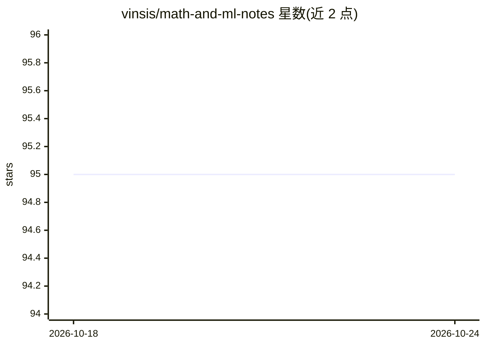

# vinsis/math-and-ml-notes

⭐ 95 · Jupyter Notebook · MIT · 推送 2026-09-28 · [GitHub](https://github.com/vinsis/math-and-ml-notes) · 个人维护

**个人维护的 ML/AI 论文与笔记链接清单**

以 markdown 勾选列表形式组织的机器学习研究资料集合：按信息论无监督学习、解耦表示、自监督学习、自动微分、神经 ODE、概率编程、Transformers、神经网格理论、变分推断、因果推断等约 10 个主题收录论文 PDF、博客与课程链接，部分条目附带个人笔记、批注 PDF 或含可运行代码的 Python notebook；作者声明将随主题学习逐步补充笔记，个别主题（如解耦表示）注明不再深入。仅含链接，无软件安装或运行内容。

## 筛选速览

| 维度 | 判定 | 备注 |
|---|---|---|
| AI 角色 | `ai-knowledge` | 知识聚合/清单类 |
| 许可风险 | `permissive` | MIT |
| 部署形态 | `None` |  |
| 模型依赖 | — | README 未给出锁定关系 |
| 硬件要求 | — | 无带数字的原话,不猜 |
| 安装摩擦 | `low` | 无编译、无系统依赖或容器化 |
| 成熟度 | — | 结构信号不足 |

## 能力要点

- 约 10 个 ML 主题分类的论文/资料勾选列表
- 部分条目附个人笔记、批注 PDF 或可运行 notebook
- 覆盖自监督学习、自动微分、因果推断等方向

## 适用场景

- 按主题查找代表性 ML 研究论文与讲解资料
- 参考他人的学习路线组织自己的论文阅读计划

## 场景标签

`精选清单` · 领域:学习与行业

## 证据(README 行号)

> L1: Links to some important research papers or links. I plan to add notes as I go through each topic one by one.
> L3: ## ✔ 1. Information theory based (unsupervised) learning

## 星数曲线

2026-10-18 95 → 2026-10-24 95（+0）

---
*卡片 v1 · prompt 1.4 · 生成 2026-10-23 · 置信度 high · 依据 README sha `51858f094594` · [字段定义](../../DATASET.md)*
