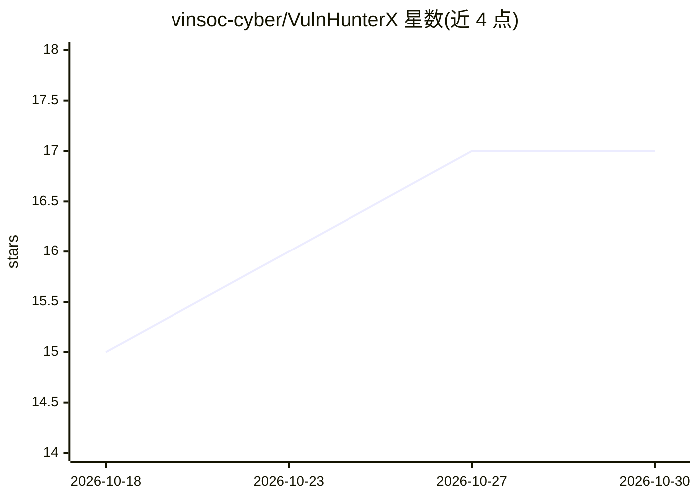

# vinsoc-cyber/VulnHunterX

⭐ 17 · Python · LGPL-2.1 · 推送 2026-10-04 · [GitHub](https://github.com/vinsoc-cyber/VulnHunterX) · 组织维护 · 中文 README

**给安全工程师：静态分析结果配 LLM 多轮验证以甄别误报**

Python 框架，将 CodeQL/Semgrep/OpenGrep 的 SARIF 发现送入多轮 LLM 验证：LLM 需先回答 394 个规则特定的引导问题，可按固定上下文词汇表索取调用方、结构体、全局变量等额外代码上下文，最终输出 TP/FP/NMD 判定与置信度。支持 C/C++/Python/JS/PHP/Java/Go/C# 八种语言，LLM 侧经 LiteLLM 接入 OpenAI/Anthropic/Gemini/DeepSeek/Ollama。四阶段 CLI（prepare→analyze→verify→report），产出英/越双语 Markdown 报告，并提供 6 个真值数据集的精确率/召回率基准。需 Python 3.12+ 与 CodeQL CLI 2.15+。

## 筛选速览

| 维度 | 判定 | 备注 |
|---|---|---|
| AI 角色 | `ai-native` | 本体是模型或模型工具 |
| 许可风险 | `viral` | LGPL-2.1 |
| 部署形态 | `library` | 以包/库形式分发 |
| 模型依赖 | local-ok | 支持本地模型 |
| 硬件要求 | — | 无带数字的原话,不猜 |
| 安装摩擦 | `medium` | 含编译或系统依赖之一 |
| 成熟度 | — | 结构信号不足 |

## 能力要点

- 多轮 LLM 验证：动态扩展上下文（callers/structs/globals/macros/free-sites）
- 394 个规则特定引导问题模板，按 7 个语言库组织
- 三种 SAST 引擎（CodeQL/Semgrep/OpenGrep）与五档规则档位
- 6 个真值数据集上的精确率/召回率基准

## 适用场景

- 对 SAST 扫描出的海量告警做自动化误报过滤
- 在本地 Ollama 模型上离线验证漏洞发现
- 批量扫描多仓库并生成 Markdown 漏洞报告

## 场景标签

`网络安全` · 领域:学习与行业

## 证据(README 行号)

> L15: SAST engines deliberately over-approximate — they flag every program point that *might* be vulnerable. The dominant
> L37: |**LLM providers**|OpenAI, Anthropic, Gemini, DeepSeek, Ollama (local or Ollama Cloud) — via LiteLLM|
> L233: vuln-hunter-x verify --provider ollama --model ollama/llama3.2 --repo libucl

## 星数曲线

2026-10-18 15 → 2026-10-30 17（+2）

---
*卡片 v1 · prompt 1.4 · 生成 2026-10-29 · 置信度 high · 依据 README sha `c74e3da681ef` · [字段定义](../../DATASET.md)*
