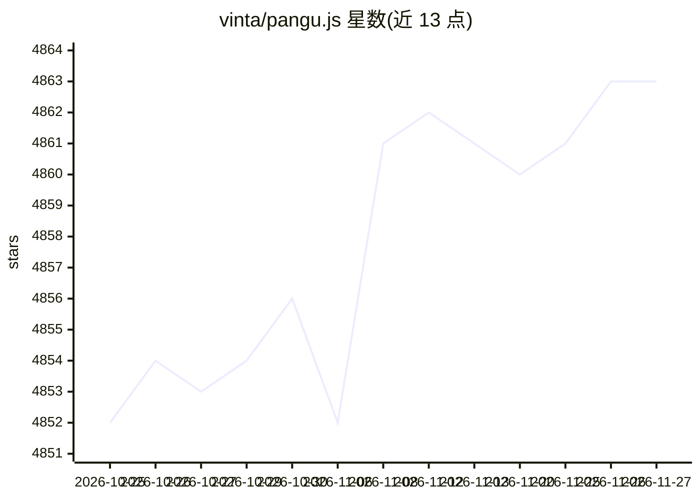

# vinta/pangu.js

⭐ 4,863 · TypeScript · MIT · 推送 2026-10-24 · [GitHub](https://github.com/vinta/pangu.js) · [官网](https://chrome.google.com/webstore/detail/paphcfdffjnbcgkokihcdjliihicmbpd) · 个人维护 · 中文 README

**为中英文/数字/符号间自动插入空格的 JS 库与 Chrome 扩展**

pangu.js 提供 JavaScript 库、命令行工具与 Chrome 扩展，在中日韩文字与半形英文、数字、符号之间自动插入空白（盘古之白）。库分浏览器 DOM-aware 构建（spaceNode/autoSpacePage）与 Node.js 构建，支持 ESM/UMD 及多个 CDN 分发。Chrome 扩展新增 AI Spacing：用 Chrome 内置 Prompt API 在设备端运行 Gemini Nano 判断符号语义（如 + 是加号还是连接符），完全离线；正则规则无法处理的语义歧义交由 LLM 判断。不适用于 Markdown 文档。

## 筛选速览

| 维度 | 判定 | 备注 |
|---|---|---|
| AI 角色 | `ai-enhanced` | 去掉 AI 部分产品仍成立 |
| 许可风险 | `permissive` | MIT |
| 部署形态 | `library` | 以包/库形式分发 |
| 模型依赖 | — | README 未给出锁定关系 |
| 硬件要求 | — | 无带数字的原话,不猜 |
| 安装摩擦 | `low` | 无编译、无系统依赖或容器化 |
| 成熟度 | — | 结构信号不足 |

## 能力要点

- JS 库+CLI+Chrome 扩展多种形态，自动在中西文间插入空格
- AI Spacing 用 Chrome Prompt API 本地运行 Gemini Nano 做语义判断，完全离线
- 浏览器版提供 DOM-aware 构建（spaceNode/autoSpacePage）与独立单文件版
- npm/jsDelivr/unpkg/cdnjs 多渠道分发

## 适用场景

- 网页浏览时自动给中英文混排加空格
- 在前端项目中批量处理 HTML 或纯文本的排版间距
- 终端里快速格式化一段中英混排文案

## 场景标签

 · 领域:文本处理/浏览器扩展

## 证据(README 行号)

> L46: Install 為什麼你們就是不能加個空格呢？ and it spaces every page you browse. It also comes with the **AI Spacing** feature:
> L60: Regex rules can't distinguish semantic nuances like these, so the extension asks an LLM. It uses Chrome's built-in 
> L66: Opinionated paranoid text spacing: automatically inserts whitespace between CJK (Chinese, Japanese, Korean) and ANS

## 星数曲线

2026-10-25 4,852 → 2026-11-27 4,863（+11）

---
*卡片 v1 · prompt 1.4 · 生成 2026-11-22 · 置信度 high · 依据 README sha `60a7d15f5f06` · [字段定义](../../DATASET.md)*
