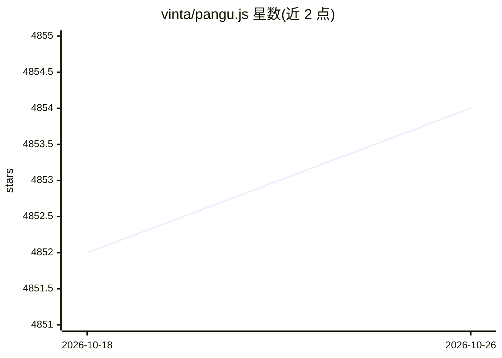

# vinta/pangu.js

⭐ 4,854 · TypeScript · MIT · 推送 2026-10-24 · [GitHub](https://github.com/vinta/pangu.js) · [官网](https://chrome.google.com/webstore/detail/paphcfdffjnbcgkokihcdjliihicmbpd) · 个人维护 · 中文 README

**在中英文之间自动插入空格的 JS 库与 Chrome 扩展**

提供 paranoid text spacing 功能：自动在 CJK 字符与半形英文字母、数字、符号之间插入空白。形态包括 npm 库（浏览器 ESM/UMD 构建、Node.js、CLI）与 Chrome 扩展。扩展附带 AI Spacing 功能，通过 Chrome 内建 Prompt API 调用设备上的 Gemini Nano，离线判断正则无法区分的语义场景（如 +/- 在不同语境的加空格方式）。限制：库明确声明不适用于 Markdown 等标记语言文档。MIT 许可。

## 筛选速览

| 维度 | 判定 | 备注 |
|---|---|---|
| AI 角色 | `ai-enhanced` | 去掉 AI 部分产品仍成立 |
| 许可风险 | `permissive` | MIT |
| 部署形态 | `library` | 以包/库形式分发 |
| 模型依赖 | — | README 未给出锁定关系 |
| 硬件要求 | — | 无带数字的原话,不猜 |
| 安装摩擦 | `low` | 无编译、无系统依赖或容器化 |
| 成熟度 | — | 结构信号不足 |

## 能力要点

- 自动在 CJK 与半形字符间插入空白
- Chrome 扩展提供 AI Spacing：经 Chrome 内建 Prompt API 在设备上运行 Gemini Nano，完全离线
- 提供浏览器构建（含 DOM 感知的 spaceNode/autoSpacePage）、Node.js 与 CLI 多种使用方式
- 分发渠道覆盖 npm、jsDelivr、unpkg、cdnjs 与 Chrome Web Store

## 适用场景

- 浏览网页时自动为中英文混排内容加空格
- 在浏览器或 Node.js 项目中调用库处理网页与纯文本
- 通过 CLI 命令快速给一段文本加空格

## 场景标签

 · 领域:文本处理/排版工具

## 证据(README 行号)

> L59: Regex rules can't distinguish semantic nuances like these, so the extension asks an LLM. It uses Chrome's built-in 
> L65: Opinionated paranoid text spacing: automatically inserts whitespace between CJK (Chinese, Japanese, Korean) and ANS

## 星数曲线

2026-10-18 4,852 → 2026-10-26 4,854（+2）

---
*卡片 v1 · prompt 1.4 · 生成 2026-10-20 · 置信度 high · 依据 README sha `99419faf04e0` · [字段定义](../../DATASET.md)*
