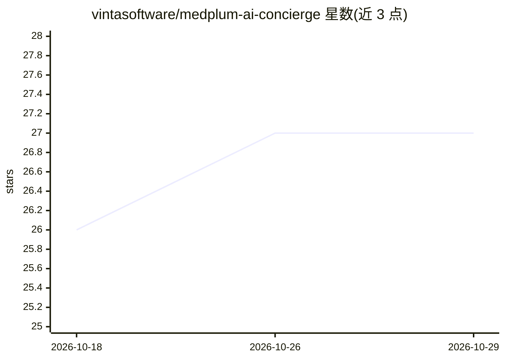

# vintasoftware/medplum-ai-concierge

⭐ 27 · TypeScript · Apache-2.0 · 推送 2026-03-17 · [GitHub](https://github.com/vintasoftware/medplum-ai-concierge) · 组织维护

**医疗仪表盘 Demo：患者对话式查询健康数据并生成图表**

基于 Next.js + CopilotKit + LangGraph 的患者端医疗仪表盘演示应用：患者通过聊天与 AI 助手交互，助手按自然语言查询动态生成生命体征图表、化验结果组件与 FHIR 数据表，并提供数据解读功能；数据以 FHIR 格式存储在 Medplum 项目中。当前版本聚焦减重与糖尿病护理，依赖 OpenAI API key 与 Medplum 项目配置，monorepo 结构（web/agent 两应用）通过 pnpm + Turbo 运行，支持患者自助注册（reCAPTCHA）。由 Vinta Software 维护。

## 筛选速览

| 维度 | 判定 | 备注 |
|---|---|---|
| AI 角色 | `ai-native` | 本体是模型或模型工具 |
| 许可风险 | `permissive` | Apache-2.0 |
| 部署形态 | `library` | 以包/库形式分发 |
| 模型依赖 | — | README 未给出锁定关系 |
| 硬件要求 | — | 无带数字的原话,不猜 |
| 安装摩擦 | `low` | 无编译、无系统依赖或容器化 |
| 成熟度 | — | 结构信号不足 |

## 能力要点

- 自然语言查询生成 13 类生命体征/化验图表组件
- Interpret Data 功能对可见组件数据生成 AI 解读
- AG-UI 协议 + CopilotKit + LangGraph 的生成式 UI 演示
- FHIR 数据存储与 FHIR Search 结构化查询组件

## 适用场景

- 患者查看并理解自己的血糖、血压等健康数据趋势
- 就诊前通过 AI 解读准备与医生的沟通
- 学习 CopilotKit + LangGraph + Medplum 的生成式 UI 集成方式

## 场景标签

`AI 助手` `数据分析` · 领域:效率与自动化

## 证据(README 行号)

> L7: The patient can chat with an AI agent and analyze their health records. The AI agent can generate graphs to display 
> L9: This application demonstrates the usage of Generative UI techniques for healthcare dashboards, specifically with the

## 星数曲线

2026-10-18 26 → 2026-10-29 27（+1）

---
*卡片 v1 · prompt 1.4 · 生成 2026-10-26 · 置信度 high · 依据 README sha `7ac0d4e400e0` · [字段定义](../../DATASET.md)*
