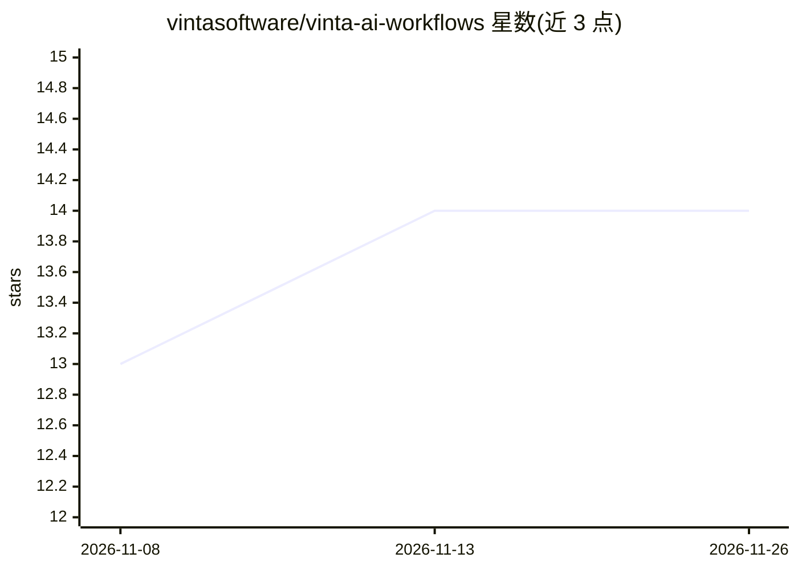

# vintasoftware/vinta-ai-workflows

⭐ 14 · TypeScript · MIT · 推送 2026-11-24 · [GitHub](https://github.com/vintasoftware/vinta-ai-workflows) · [官网](https://vintasoftware.github.io/vinta-ai-workflows/) · 组织维护

**向项目注入 AI 工作流引导技能与多厂商配置的 npm CLI**

以 npm 包形式分发的引导工具：CLI 将一次性 bootstrap 技能安装到项目的各厂商技能目录（Claude Code、Codex、Cursor、VS Code + GitHub Copilot），生成 AGENTS.md（含各厂商别名符号链接）、项目专属子代理与技能及多厂商布线。引导后提供三个基础技能：create-spec 通过访谈生成规格文档、plan-feature 生成分阶段交付计划、implement-plan 按依赖图逐阶段执行（并行 lane、审查循环、分支策略），后续升级经 vinta-sync-ai-tools 同步。要求 Node ≥ 18。

## 筛选速览

| 维度 | 判定 | 备注 |
|---|---|---|
| AI 角色 | `ai-ecosystem` | LLM/agent 周边工具 |
| 许可风险 | `permissive` | MIT |
| 部署形态 | `library` | 以包/库形式分发 |
| 模型依赖 | — | README 未给出锁定关系 |
| 硬件要求 | — | 无带数字的原话,不猜 |
| 安装摩擦 | `low` | 无编译、无系统依赖或容器化 |
| 成熟度 | — | 结构信号不足 |

## 能力要点

- 一次性 bootstrap 技能安装后自动移除，不污染斜杠菜单
- create-spec → plan-feature → implement-plan 三段式工作流
- 按依赖图的并行阶段执行（每 phase 独立 worktree 与测试环境）
- vinta-sync-ai-tools 命令同步后续技能与模板更新

## 适用场景

- 给现有项目初始化 Claude Code / Cursor / Copilot 等 AI 工具的统一配置
- 用规格-计划-执行流程把需求票据推进到合并代码
- 多项目间保持同一套 AI 工作流模板不漂移

## 场景标签

`编码 Agent` `提示工程` · 领域:Agent 开发

## 证据(README 行号)

> L3: Bootstrap AI tooling — AGENTS.md, sub-agents, project skills, multi-vendor wiring — into any project, then get out o
> L5: Distributed as an npm package (`vinta-ai-workflows`) with a CLI that installs / updates / uninstalls a set of one-sh

## 星数曲线

2026-11-08 13 → 2026-11-26 14（+1）

---
*卡片 v1 · prompt 1.4 · 生成 2026-11-18 · 置信度 high · 依据 README sha `97c8be2edb68` · [字段定义](../../DATASET.md)*
